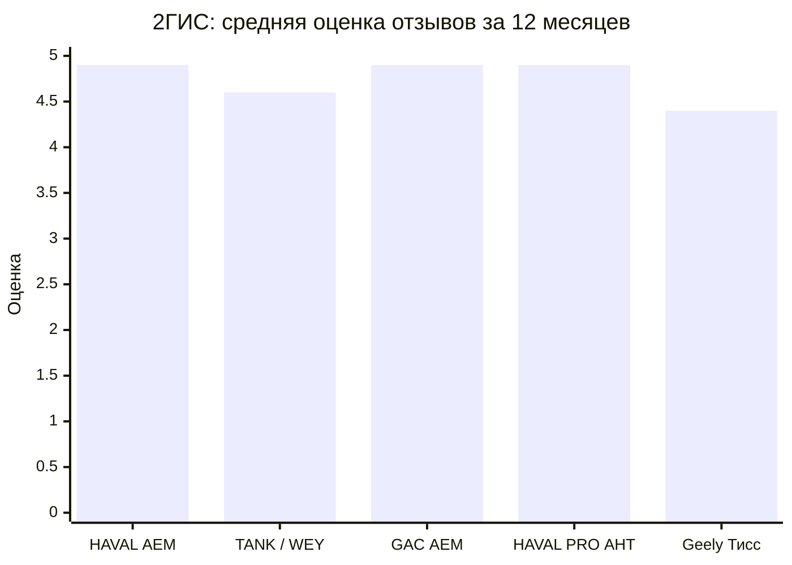
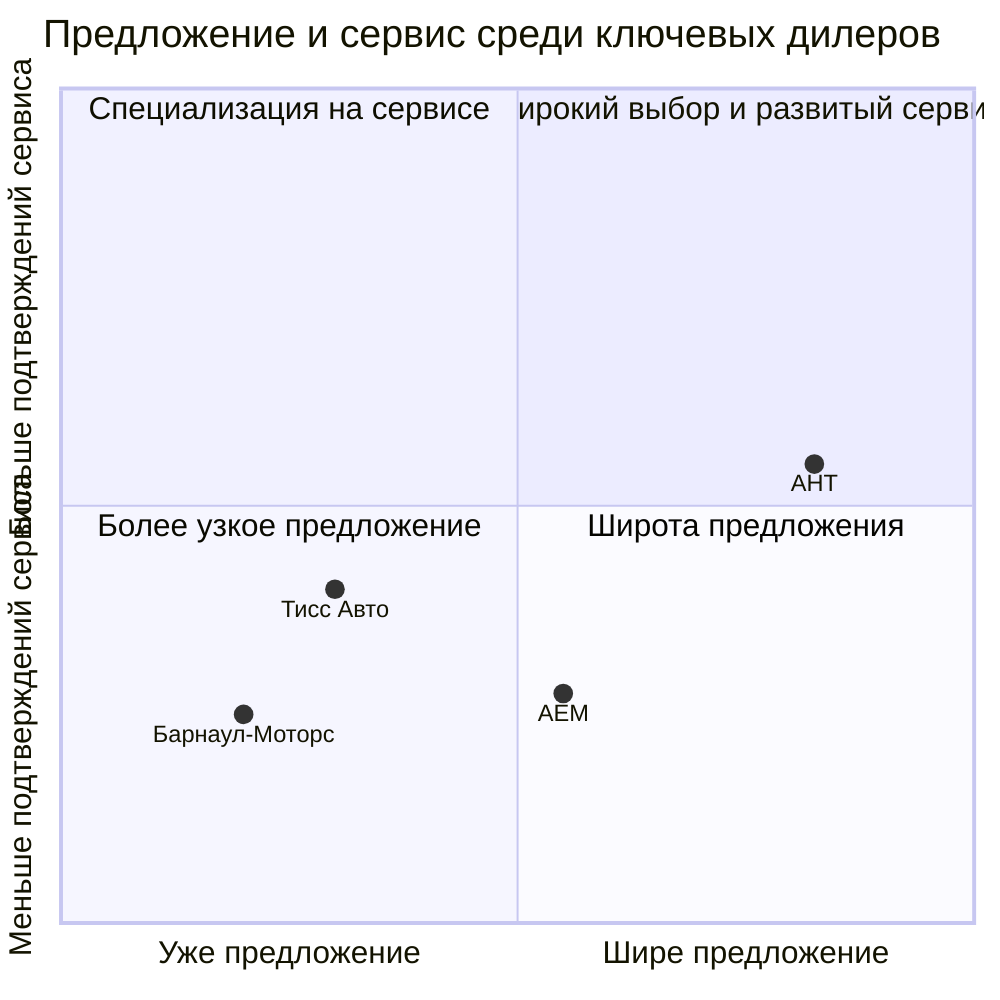

# АЕМ Холдинг

## Маркетинговое исследование автомобильного рынка Алтайского края

**26 ноября 2026 · Барнаул, Бийск, Рубцовск, Новоалтайск**  
Для собственников, генерального директора и руководителей коммерции, маркетинга и сервиса.

## Управленческое резюме

**У АЕМ есть доказуемое преимущество в сопровождении покупки и возможность удерживать клиента при смене марки. Превратить это в преимущество группы можно через единые условия сделки, приёмку и сопровождение ремонта.** Покупатели уже описывают переходы между Toyota, TANK, GAC и сервисом Lexus. Эти истории показывают, что клиент может оставаться с АЕМ при смене автомобиля. Частота таких переходов пока неизвестна. [A05](<https://2gis.ru/barnaul/firm/70000001080690595/tab/reviews>) · [A06](<https://2gis.ru/barnaul/firm/70000001080690649/tab/reviews>) · [A07](<https://2gis.ru/barnaul/firm/70000001093322428/tab/reviews>) · [A20](<https://www.toyota.ru/toyota-world/dealers/list>) · [A21](<https://www.lexus.ru/lexus-world/dealers/list>)

| Что важно руководству | Наблюдение | Решение на 90 дней |
|---|---|---|
| **20 лет работы** | Дилерский старт в октябре 2006 года. Юрлицо «АлтайЕвроМоторс» зарегистрировано в 2005-м, действующие операторы появились позже. | Зафиксировать одну дату отсчёта и показать преемственность команды и сервиса через проверяемые события. |
| **Два соседних адреса** | Павловский тракт, 164 и 164А. Четыре марки выделены на главной, WEY имеет свой сайт, Toyota, Lexus и Kia присутствуют в списках марок. | Единая карта входов, операторов, актуальных брендов и доступных работ. Первым исправить адрес GAC. |
| **265 уникальных отзывов** | 155 — подразделения АЕМ, 110 — три конкурента. У покупателей сильнее всего звучит работа сотрудников. В сервисных кейсах высока цена одного сбоя. | Запустить пилот контроля приёмки, графика гарантийных работ и обработки претензий. |
| **Три вида конкурентного давления** | «Барнаул-Моторс» — прямой HAVAL CITY-соперник. АНТ — широкий портфель и HAVAL PRO. «Тисс Авто» — Geely, Changan и электрифицированные модели. | Измерять разницу в цене одинаковых комплектаций отдельно от альтернативных моделей. |
| **Рост рынка после снижения** | Регистрации новых авто в крае снизились на 9% за 2025 год и выросли на 17% в I полугодии 2026 года. Вторичный рынок по Дрому прибавил 6% за январь–октябрь 2026 года. | Держать раздельные воронки новых авто, пробега и сервиса. Смотреть маржу и оборачиваемость наряду с числом сделок. |
| **Разная экономика операторов** | Все три указанных на сайте юрлица показали убыток от продаж в 2025 году. У двух чистый результат положительный. | Сверить маржу по VIN, ДЦ и источнику лида до увеличения расходов на привлечение. |

Источники к резюме. [A01](<https://aemholding.ru/contact>) · [A02](<https://aemholding.ru/>) · [A06](<https://2gis.ru/barnaul/firm/70000001080690649/tab/reviews>) · [A07](<https://2gis.ru/barnaul/firm/70000001093322428/tab/reviews>) · [A14](<https://gac-barnaul.ru/>) · [A19](<https://www.kia.ru/dealers/barnaul/333/>) · [A20](<https://www.toyota.ru/toyota-world/dealers/list>) · [A21](<https://www.lexus.ru/lexus-world/dealers/list>) · [A38](<https://e-ecolog.ru/buh/2025/2222862784>) · [A40](<https://e-ecolog.ru/buh/2025/2222863185>) · [A42](<https://b2b.house/company/OOO-AEM-AVTO_5585057f-3417-4b8c-984b-46ea87511377/financial-statements/>) · [C01](<https://www.ant22.ru/contacts/>) · [C09](<https://barnaulmotors-haval.ru/about-dealer/>) · [C12](<https://changanauto.ru/customers/dealer/cangan-centr-tiss-atvto>) · [C25](<https://dilerskie-centry.ru/barnaul/haval>) · [R02](<https://asroad.org/news/pressa-o-nas/pereraspredelenie-dolej-kto-usilivaet-poziczii-na-sibirskom-rynke-novyh-avto-po-itogam-2025-goda/>) · [R03](<https://asroad.org/news/novosti-rynka/rekordy-i-provaly-chto-proizoshlo-s-avtorynkom-sibiri-v-pervom-polugodii-2026-goda-i-k-chemu-gotovitsya-dalshe/>) · [R06](<https://www.asferainfo.ru/news/136240-prodazi-avtomobilej-s-probegom-v-altajskom-krae-vyrosli-na-8-za-mesac>)

### Десять выводов для собственника

1. **АЕМ — региональный мультибрендовый оператор с компактной географией.** Доказательная база относится прежде всего к двум барнаульским адресам. [A01](<https://aemholding.ru/contact>) · [A02](<https://aemholding.ru/>) · [A03](<https://aem-service.ru/>)
2. **Главная, контакты и витрина отвечают на вопрос о портфеле по-разному.** Клиенту приходится самостоятельно определять, где купить машину, обслужить её или получить гарантийную помощь. [A01](<https://aemholding.ru/contact>) · [A02](<https://aemholding.ru/>) · [A19](<https://www.kia.ru/dealers/barnaul/333/>) · [A20](<https://www.toyota.ru/toyota-world/dealers/list>) · [A21](<https://www.lexus.ru/lexus-world/dealers/list>) · [A24](<https://aemholding.ru/cars?brand=geely>)
3. **Самый близкий ценовой ориентир для HAVAL CITY — «Барнаул-Моторс».** АНТ конкурирует за тот же бюджет и покупателя SUV через PRO и другие марки. [C01](<https://www.ant22.ru/contacts/>) · [C23](<https://www.ant22.ru/new_cars/35775/>) · [C24](<https://auto.drom.ru/barnaul/haval/jolion/generation1/restyling2/year-2026/compl550336/new/>) · [C25](<https://dilerskie-centry.ru/barnaul/haval>)
4. **АЕМ — единственный локальный GAC и TANK в проверенных профильных списках Барнаула.** Уникальность салона внутри марки даёт входящий спрос. Соперники сохраняются между марками и на вторичном рынке. [A46](<https://dilerskie-centry.ru/barnaul/tank>) · [A47](<https://dilerskie-centry.ru/barnaul/gac>) · [C15](<https://www.albion-motors.ru/>) · [C29](<https://auto.drom.ru/dealers/barnaul/new/>)
5. **Высокая оценка на карте скрывает различия во времени.** В октябрьском срезе свежая средняя TANK — 4,6 при накопленной 4,9. У HAVAL АЕМ — 4,9 при накопленной 5,0. [A09](<https://dilerskie-centry.ru/dc/aem-kholding-haval-barnaul>) · [A10](<https://dilerskie-centry.ru/dc/aem-kholding-tank-barnaul>)
6. **Персональный подход виден чаще всего.** В 121 отзывах АЕМ упоминаются менеджеры или сотрудники. Для группы важна воспроизводимость этого опыта при смене консультанта. [A05](<https://2gis.ru/barnaul/firm/70000001080690595/tab/reviews>) · [A06](<https://2gis.ru/barnaul/firm/70000001080690649/tab/reviews>) · [A07](<https://2gis.ru/barnaul/firm/70000001093322428/tab/reviews>) · [A08](<https://chesnok.ai/autodealers/barnaul/haval/ayem-kholding-haval-pavlovskiy-trakt-164/reviews>)
7. **Обещание до визита влияет на доверие после визита.** Отзывы описывают и заранее подготовленную выдачу, и поездку ради автомобиля с расходящимся описанием. [A05](<https://2gis.ru/barnaul/firm/70000001080690595/tab/reviews>) · [A06](<https://2gis.ru/barnaul/firm/70000001080690649/tab/reviews>) · [A07](<https://2gis.ru/barnaul/firm/70000001093322428/tab/reviews>)
8. **По трём юрлицам выручка двигалась разнонаправленно.** Публичная отчётность требует раздельного чтения прибыли от продаж, чистой прибыли и структуры прочих доходов. [A38](<https://e-ecolog.ru/buh/2025/2222862784>) · [A40](<https://e-ecolog.ru/buh/2025/2222863185>) · [A42](<https://b2b.house/company/OOO-AEM-AVTO_5585057f-3417-4b8c-984b-46ea87511377/financial-statements/>)
9. **У АЕМ есть связка пробега, новых автомобилей и сервиса.** Её применение видно в отдельных переходах клиента между категориями и марками. Экономика переходов пока неизвестна. [A03](<https://aem-service.ru/>) · [A05](<https://2gis.ru/barnaul/firm/70000001080690595/tab/reviews>) · [A06](<https://2gis.ru/barnaul/firm/70000001080690649/tab/reviews>) · [A07](<https://2gis.ru/barnaul/firm/70000001093322428/tab/reviews>) · [A26](<https://auto.drom.ru/aemtrade-in/lexus/nx200/generation1/year-2018/suv/>)
10. **Покупка и сервис требуют отдельных показателей.** Продажные отзывы дают свидетельства о консультациях и выдаче. Сервисные — о записи, ремонте, сроках и коммуникации. [A05](<https://2gis.ru/barnaul/firm/70000001080690595/tab/reviews>) · [A06](<https://2gis.ru/barnaul/firm/70000001080690649/tab/reviews>) · [A07](<https://2gis.ru/barnaul/firm/70000001093322428/tab/reviews>) · [C03](<https://2gis.ru/barnaul/firm/70000001100825209/tab/reviews>) · [C05](<https://2gis.ru/barnaul/firm/70000001044930441/tab/reviews>) · [C07](<https://chesnok.ai/autodealers/barnaul/haval/barnaul-motors-haval-kalinina-31/reviews>)

### Что усиливать и что исправлять

| № | Сильная сторона, которую можно предъявить | Риск или недостаток | Приоритетная мера |
|---:|---|---|---|
| 1 | История дилерской работы с 2006 года | Разный возраст группы на брендовых сайтах | Единая история с датами и кейсами |
| 2 | Два соседних адреса для сравнения марок | Расходятся 164 и 164А в контактах GAC | Справочник входов, адресов и операторов |
| 3 | Разные ценовые сегменты в одном портфеле | Часть предложений пересекается внутри группы | Маршрутизация по потребности и парные тест-драйвы |
| 4 | Редкое локальное присутствие GAC и TANK | Зависимость от товарных решений дистрибьюторов | Собственное предложение сервиса и владения |
| 5 | Сильные отзывы о работе консультантов | Опыт может зависеть от конкретного сотрудника | Стандарт ответа и резервный владелец лида |
| 6 | Отдельная витрина автомобилей с пробегом | Расхождения в описании и оценке до визита | Диагностическая карточка и диапазон trade-in |
| 7 | Кредит, лизинг, страхование, обмен | Рекламная цена требует сопоставления условий | Три сценария цены по одному VIN |
| 8 | Гарантия, ТО и кузовной ремонт | Клиенту трудно наблюдать ход сложного кейса | Статус гарантии и следующая дата связи |
| 9 | Подтверждённые в отзывах переходы между марками | Нет публичной метрики удержания | Следующее ТО при выдаче, единая история клиента |
| 10 | Накопленная видимость карточки HAVAL | Ответы видны чаще, чем подтверждённые исходы | Очередь претензий и контроль решения |

Источники к таблице. [A01](<https://aemholding.ru/contact>) · [A03](<https://aem-service.ru/>) · [A04](<https://aem-service.ru/category/>) · [A05](<https://2gis.ru/barnaul/firm/70000001080690595/tab/reviews>) · [A06](<https://2gis.ru/barnaul/firm/70000001080690649/tab/reviews>) · [A07](<https://2gis.ru/barnaul/firm/70000001093322428/tab/reviews>) · [A09](<https://dilerskie-centry.ru/dc/aem-kholding-haval-barnaul>) · [A10](<https://dilerskie-centry.ru/dc/aem-kholding-tank-barnaul>) · [A13](<https://aem-tank.ru/>) · [A14](<https://gac-barnaul.ru/>) · [A26](<https://auto.drom.ru/aemtrade-in/lexus/nx200/generation1/year-2018/suv/>) · [A34](<https://www.zr.ru/content/articles/100243-barnaulskij_debut_volkswagen/>) · [A36](<https://www.amic.ru/news/transport/vse-modeli-uzhe-est-barnaulskiy-diler-yaponskih-koreyskih-i-nemeckih-avtomobiley-rasskazal-kak-zarabotal-parallelnyy-import-514506>) · [C05](<https://2gis.ru/barnaul/firm/70000001044930441/tab/reviews>) · [C08](<https://dilerskie-centry.ru/dc/barnaul-motors-haval>)

## 1. Профиль, бренд и репутация АЕМ

### 1.1. Идентификация и юридический периметр

Русское коммерческое имя **АЕМ Холдинг**, на корпоративном сайте также употребляется **AEM Холдинг**. Историческое имя — **«АлтайЕвроМоторс»**. Написание IEM использовалось в исходном задании, подтверждения его корпоративного использования нет. Дилерские карточки, адреса, реквизиты и исторические публикации позволяют связать найденные площадки с одной барнаульской группой. [A01](<https://aemholding.ru/contact>) · [A02](<https://aemholding.ru/>) · [A32](<https://altapress.ru/story/barnaulskie-avtodiler-otkazalsya-ot-skoda-v-polzu-toyota-216681>) · [A34](<https://www.zr.ru/content/articles/100243-barnaulskij_debut_volkswagen/>) · [A45](<https://www.tbank.ru/business/contractor/legal/1052202217440/>)

| Юрлицо | ИНН / ОГРН | Публичная связь и установленная роль | Уверенность |
|---|---|---|---|
| ООО «АЕМ» | 2222862784 / 1172225041174 | Зарегистрировано 19.10.2017. Руководитель Дмитрий Борисов. Рихард Фаллер 75%, Дмитрий Борисов 25% по раскрытой карточке. Оператор сайта GAC, дилер BELGEE по документам, ООО в списках Toyota и Lexus. | Высокая для связи |
| ООО «АЕМ-Премиум» | 2222863185 / 1172225043308 | Зарегистрировано 02.11.2017. Руководитель Дмитрий Борисов, доли 75% / 25% у Фаллера и Борисова. Рекламодатель в карточке TANK/WEY, фигурирует в документе TANK. | Высокая для связи |
| ООО «АЕМ-Авто» | 2222075681 / 1082222006602 | Барнаул, Павловский тракт, 164. Руководитель Дмитрий Борисов. ООО в реестре Kia. | Высокая для связи |
| ООО «АлтайЕвроМоторс» | 2224095436 / 1052202217440 | Создано 13.07.2005, в досье отмечено действующим. Руководитель Дмитрий Борисов. Историческое дилерское юрлицо Volkswagen, связь с действующим бизнесом подтверждается по адресу и руководителю. | Высокая историческая, средняя операционная |
| ООО «АЕМ-Сервис» (2022) | 2223639147 / 1222200000219 | Руководитель Дмитрий Борисов, Фаллер 60%, Борисов 40% по агрегатору. Адрес 164А. Прямая привязка к договорам публичного сервиса требует отдельного подтверждения. | Средняя |
| ООО «АЕМ-Сервис» (2008) | 2222076893 / 1082222008252 | Отдельное одноимённое, ликвидированное юрлицо. | Высокая для отличия |

Сайт указывает первые три юрлица. Доли относятся к конкретным ООО. Формальная организационная схема всей группы, список бенефициаров на уровне холдинга и роли основателей в сделке 2006 года в доступных источниках не установлены. Интервью 2022 года называет управляющим директором Константина Шестака на момент публикации. Среднесписочная численность ООО «АЕМ» составляла 39 человек в 2024 году по Rusprofile. Общая численность группы неизвестна. [A01](<https://aemholding.ru/contact>) · [A06](<https://2gis.ru/barnaul/firm/70000001080690649/tab/reviews>) · [A15](<https://gac-barnaul.ru/politics>) · [A17](<https://belgee-aem.ru/perechen-tret-ikh-lits/>) · [A19](<https://www.kia.ru/dealers/barnaul/333/>) · [A20](<https://www.toyota.ru/toyota-world/dealers/list>) · [A21](<https://www.lexus.ru/lexus-world/dealers/list>) · [A36](<https://www.amic.ru/news/transport/vse-modeli-uzhe-est-barnaulskiy-diler-yaponskih-koreyskih-i-nemeckih-avtomobiley-rasskazal-kak-zarabotal-parallelnyy-import-514506>) · [A37](<https://www.rusprofile.ru/id/11202308>) · [A39](<https://www.rusprofile.ru/id/11222307>) · [A41](<https://b2b.house/company/OOO-AEM-AVTO_5585057f-3417-4b8c-984b-46ea87511377/>) · [A43](<https://www.reabiz.ru/organization/1222200000219-aem-servis>) · [A44](<https://www.klerk.ru/tool/ocompany/1082222008252/>) · [A45](<https://www.tbank.ru/business/contractor/legal/1052202217440/>) · [A51](<https://tank.ru/list-of-third-parties/>)

### 1.2. Хронология

| Период | Событие | Что подтверждено |
|---|---|---|
| 2005 | Регистрация ООО «АлтайЕвроМоторс» | Регистрационная запись, отдельно от дилерского старта. |
| Октябрь 2006 | Дилерское соглашение Volkswagen | Корпоративная дата отсчёта. Отраслевой архив подтверждает первые поставки и дилерский дебют. За выставочную экспозицию упомянут диплом «Алтайской ярмарки». |
| 2009 | Škoda расширяет европейский портфель | Корпоративная история и публикация об окончании дилерства в 2018-м. |
| 2010–2011 | Начало работы с Audi | Алтапресс указывает 2010 год, АЕМ — 2011-й. Открытие полноценного Audi Центра на Павловском тракте датируется 2015 годом в Алтапресс. |
| 2016 | Тендер и намерение по Porsche | Источники подтверждают переговоры и протокол о намерениях. Информация о действовавшем центре АЕМ Porsche не обнаружена. |
| 2017–2019 | Toyota и Lexus, смена профиля площадки | Тендер в 2017-м, временная продажа Toyota в 2018-м и выход из Škoda. Корпоративная хроника ставит открытие нового центра в 2019-м. |
| 2020 | Kia | Дата указана АЕМ, активная карточка марки указывает адрес 164. |
| 2022 | Параллельный импорт | По интервью АЕМ наладил альтернативный ввоз и работал с парком европейских и азиатских марок. Это историческое свидетельство. |
| 2023 | HAVAL и TANK | Старт указан в корпоративной истории, действующие локальные площадки подтверждаются по сайтам и карточкам. |
| 2024 | GAC | Открытие по истории группы, действующий дилерский ресурс. |
| 2025 | Geely, BELGEE и KNEWSTAR | Корпоративная история. Для BELGEE есть действующий дилерский сайт и реквизиты. Текущая авторизация Geely и KNEWSTAR требует проверки. |
| 2026 | 20 лет от дилерского старта | Главная прямо использует двадцатилетие. WEY подтверждается отдельным локальным сайтом и общей карточкой с TANK, точная дата запуска не установлена. |

Публикации подтверждают историю через конкретные марки и площадки. Ценность юбилея для маркетинга выше там, где его можно связать с открытием центра, компетенцией команды и сопровождением существующего автомобильного парка. [A01](<https://aemholding.ru/contact>) · [A02](<https://aemholding.ru/>) · [A06](<https://2gis.ru/barnaul/firm/70000001080690649/tab/reviews>) · [A12](<https://aem-haval.ru/about-dealer/>) · [A14](<https://gac-barnaul.ru/>) · [A16](<https://belgee-aem.ru/>) · [A18](<https://gwm-wey-aem.ru/contacts/>) · [A19](<https://www.kia.ru/dealers/barnaul/333/>) · [A32](<https://altapress.ru/story/barnaulskie-avtodiler-otkazalsya-ot-skoda-v-polzu-toyota-216681>) · [A33](<https://altapress.ru/story/skoda-hochet-vernutsya-v-barnaul-219099>) · [A34](<https://www.zr.ru/content/articles/100243-barnaulskij_debut_volkswagen/>) · [A35](<https://www.autostat.ru/news/26173/>) · [A36](<https://www.amic.ru/news/transport/vse-modeli-uzhe-est-barnaulskiy-diler-yaponskih-koreyskih-i-nemeckih-avtomobiley-rasskazal-kak-zarabotal-parallelnyy-import-514506>) · [A45](<https://www.tbank.ru/business/contractor/legal/1052202217440/>)

### 1.3. Портфель и карта операций

| Марка / направление | Адрес | Статус и предложение | Альтернатива в крае |
|---|---|---|---|
| HAVAL CITY | Павловский тракт, 164 | Локальный официальный дилер. Массовые SUV, в том числе Jolion, M6, F7 и Dargo в локальной витрине. | «Барнаул-Моторс» для CITY, АНТ для PRO и смежных SUV. |
| TANK | 164А | Локальный официальный дилер. Рамные SUV 300, 400, 500, 700. TANK 300 в одной карточке 4,799 млн ₽. | HAVAL PRO, Jetour T2, EXEED и импортные SUV как варианты для разных задач. |
| WEY | 164А | Отдельный локальный сайт официального дилера, собственная витрина на Дроме и общая карточка TANK/WEY. Премиальные гибриды. | Гибриды Deepal, Geely и другие модели локальных дилеров. |
| GAC | 164А по профильному сайту, политике и картам | GS4, GS8, S7, S9, M8, Empow и другие позиции в каталоге. Корпоративный список показывает 164. | Тисс и АНТ по семейным кроссоверам, Альбион по премиальным SUV. |
| BELGEE | 164А | Официальный дилер по правовому документу. S50, новый X50, X50+, X70. От 1,730 млн ₽ для S50 в витрине. | Geely «Тисс Авто», HAVAL CITY, LADA и TENET по цене и назначению. |
| Toyota и Lexus | 164А | АЕМ в локальных списках обоих производителей, свои сайты и сервис. Происхождение каждой машины, поставку и гарантию нужно определять по VIN и условиям сделки. | Мультибрендовый импорт и вторичный рынок. |
| Kia | 164 | Реестр Kia показывает ООО «АЕМ-Авто». Сервис и присутствие карточки подтверждены, сплошной аудит поставок не проведён. | Локальный рынок новых массовых моделей и независимый сервис. |
| Geely | Корпоративный каталог и исторические материалы | Есть витрина АЕМ и карточка Drom. Один профильный каталог подтверждает в Барнауле только «Тисс Авто». Действующее дилерство АЕМ у производителя не установлено. | «Тисс Авто» — подтверждённый Geely. |
| KNEWSTAR | Исторический портфель 2025 | Упоминание в хронологии. Информация о действующем отдельном официальном ДЦ не обнаружена. | Geely и другие среднеценовые SUV. |
| Volkswagen, Audi, Škoda и Porsche | Исторические и сервисные следы | Volkswagen и Audi подтверждены как история и сервисные марки. Škoda ушла из продаж АЕМ в 2018-м. Porsche — публично обозначенный проект 2016 года. | Другие мультибрендовые СТО и специализация по отдельным маркам. |
| Пробег и Trade-in | 164 в контактах, 164А в карточке Drom | Продажа, оценка, выкуп, обмен. Drom и корпоративная витрина раскрывают ассортимент. Точный вход и адрес для визита требуют единой публикации. | Дилерские трейд-ин площадки, независимые продавцы, частные объявления. |

Источники по статусам и ценам. [A01](<https://aemholding.ru/contact>) · [A03](<https://aem-service.ru/>) · [A12](<https://aem-haval.ru/about-dealer/>) · [A13](<https://aem-tank.ru/>) · [A14](<https://gac-barnaul.ru/>) · [A15](<https://gac-barnaul.ru/politics>) · [A16](<https://belgee-aem.ru/>) · [A17](<https://belgee-aem.ru/perechen-tret-ikh-lits/>) · [A18](<https://gwm-wey-aem.ru/contacts/>) · [A19](<https://www.kia.ru/dealers/barnaul/333/>) · [A20](<https://www.toyota.ru/toyota-world/dealers/list>) · [A21](<https://www.lexus.ru/lexus-world/dealers/list>) · [A22](<https://toyota-aem.ru/>) · [A23](<https://lexus-aem.ru/>) · [A24](<https://aemholding.ru/cars?brand=geely>) · [A25](<https://barnaul.drom.ru/dealers/geely/>) · [A26](<https://auto.drom.ru/aemtrade-in/lexus/nx200/generation1/year-2018/suv/>) · [A32](<https://altapress.ru/story/barnaulskie-avtodiler-otkazalsya-ot-skoda-v-polzu-toyota-216681>) · [A33](<https://altapress.ru/story/skoda-hochet-vernutsya-v-barnaul-219099>) · [A35](<https://www.autostat.ru/news/26173/>) · [A46](<https://dilerskie-centry.ru/barnaul/tank>) · [A47](<https://dilerskie-centry.ru/barnaul/gac>) · [A48](<https://gac-barnaul.ru/cars>) · [A49](<https://aemholding.ru/cars/2310511>) · [A60](<https://auto.drom.ru/dealer327725/>) · [C14](<https://geely-tissauto.ru/cars/>) · [C15](<https://www.albion-motors.ru/>) · [C25](<https://dilerskie-centry.ru/barnaul/haval>) · [C26](<https://dilerskie-centry.ru/barnaul/geely>) · [C29](<https://auto.drom.ru/dealers/barnaul/new/>)

Ключевой риск диверсификации — одновременное присутствие HAVAL, BELGEE и GAC на соседних площадках при пересечении запросов городской и семейной аудитории. BELGEE производит автомобили в Беларуси. В верхнем сегменте сходятся GAC, TANK и WEY. Коммерческая выгода появляется, если менеджер может передать клиента внутри группы с сохранением запроса, бюджета и истории контакта. Риск появляется, если дирекции отдельных марок начинают конкурировать за один лид без общего учёта. Доли производителей, внутренняя каннибализация и структура запасов по маркам неизвестны. [A01](<https://aemholding.ru/contact>) · [A02](<https://aemholding.ru/>) · [A13](<https://aem-tank.ru/>) · [A14](<https://gac-barnaul.ru/>) · [A16](<https://belgee-aem.ru/>) · [A18](<https://gwm-wey-aem.ru/contacts/>) · [A59](<https://belgee.ru/about-belgee/>) · [C29](<https://auto.drom.ru/dealers/barnaul/new/>)

| Направление | Что подтверждено | Целевая аудитория и деловое значение |
|---|---|---|
| Новые автомобили | Марочные сайты, наличие, тест-драйв, отдельные контакты | Покупатели массовых SUV, семейных и премиальных моделей. Два адреса дают возможность посмотреть несколько марок за визит. |
| Пробег, выкуп, обмен | Корпоративный каталог, канал trade-in на Drom, отзывы об оценке | Клиент с имеющимся автомобилем или бюджетом ниже нового. Канал для перехода между новым и пробегом. |
| Кредит, страхование и лизинг | Услуги в корпоративном меню, дилерские программы и сноски о партнёрах | Клиенту требуется полный расчёт по способу оплаты. В сделке участие банка отличается от решения дилера. |
| Гарантия и послепродажный сервис | Точки марок, техническое обслуживание, диагностика, слесарный и кузовной ремонт | Владельцы текущих и прежних марок, в том числе купившие автомобиль в другом месте. |
| Запчасти, аксессуары, дополнительное оборудование | Корпоративная декларация о рознице и опте, марочные предложения и подтверждающие кейсы установки | Владельцы, сервисные клиенты и покупатели при выдаче. Разбивка по оригинальным и альтернативным деталям публично неполна. |
| Корпоративная продажа | Есть лизинг и отдельное свидетельство о срочной покупке организацией | Потенциал сопровождения парков требует отдельной проверки. Публичных данных о масштабе B2B нет. |

Источники к операциям. [A01](<https://aemholding.ru/contact>) · [A03](<https://aem-service.ru/>) · [A04](<https://aem-service.ru/category/>) · [A05](<https://2gis.ru/barnaul/firm/70000001080690595/tab/reviews>) · [A06](<https://2gis.ru/barnaul/firm/70000001080690649/tab/reviews>) · [A07](<https://2gis.ru/barnaul/firm/70000001093322428/tab/reviews>) · [A12](<https://aem-haval.ru/about-dealer/>) · [A26](<https://auto.drom.ru/aemtrade-in/lexus/nx200/generation1/year-2018/suv/>) · [A50](<https://aem-haval.ru/online-stock/>)

### 1.4. Финансовый срез

Млн ₽. Выручка и результаты взяты из строк бухгалтерской отчётности отдельных юрлиц. Результат от продаж и чистая прибыль отражают разные уровни отчёта.

| Юрлицо | Выручка 2024 | Выручка 2025 | Изменение | Прибыль от продаж 2025 | Чистая прибыль 2025 |
|---|---:|---:|---:|---:|---:|
| ООО «АЕМ» | 334,854 | 1 333,006 | +298,1% | −136,764 | −22,689 |
| ООО «АЕМ-Премиум» | 2 278,497 | 2 100,770 | −7,8% | −27,960 | +85,001 |
| ООО «АЕМ-Авто» | ≈2 001 | 1 593,781 | −20,3% | −26,346 | +12,735 |

ООО «АЕМ» увеличило выручку почти вчетверо, при этом валовая прибыль уменьшилась с 36,818 до 13,363 млн ₽. Этому соответствовало увеличение коммерческих расходов со строки 2210. Отчётность не раскрывает, связано ли изменение со сменой ассортимента, переводом оборота между операторами, условиями поставщиков или иными факторами. Остальные два юрлица показали положительную чистую прибыль при отрицательной прибыли от продаж. Проверка влияния прочих доходов, бонусов и внутригрупповых операций нужна перед выводом о рентабельности каналов. Консолидированная выручка, доля рынка и фактические сделки по маркам не раскрыты. [A37](<https://www.rusprofile.ru/id/11202308>) · [A38](<https://e-ecolog.ru/buh/2025/2222862784>) · [A40](<https://e-ecolog.ru/buh/2025/2222863185>) · [A41](<https://b2b.house/company/OOO-AEM-AVTO_5585057f-3417-4b8c-984b-46ea87511377/>) · [A42](<https://b2b.house/company/OOO-AEM-AVTO_5585057f-3417-4b8c-984b-46ea87511377/financial-statements/>)

### 1.5. Корпоративный бренд, сайты и медиа

Корпоративное обещание — быть надёжным дилером, повышать качество продажи и сервиса, сопровождать клиента персонально. На корпоративной странице доминирует локальная история, в метаданных главной используется более широкий тезис о масштабе. Независимого источника, подтверждающего федеральное лидерство, не найдено. В 2ГИС у покупателя на первом плане часто HAVAL, GAC или TANK/WEY, у держателя Toyota, Lexus или Kia — марочный сайт. АЕМ работает как общий знак над дилерскими точками, но понятность этой связи меняется по каналу. [A01](<https://aemholding.ru/contact>) · [A02](<https://aemholding.ru/>) · [A05](<https://2gis.ru/barnaul/firm/70000001080690595/tab/reviews>) · [A06](<https://2gis.ru/barnaul/firm/70000001080690649/tab/reviews>) · [A07](<https://2gis.ru/barnaul/firm/70000001093322428/tab/reviews>) · [A12](<https://aem-haval.ru/about-dealer/>) · [A18](<https://gwm-wey-aem.ru/contacts/>) · [A19](<https://www.kia.ru/dealers/barnaul/333/>) · [A20](<https://www.toyota.ru/toyota-world/dealers/list>) · [A21](<https://www.lexus.ru/lexus-world/dealers/list>)

| Цифровая точка | Что работает в публичном интерфейсе | Что мешает переходу к следующему действию |
|---|---|---|
| aemholding.ru | Новые, пробег, финансовые услуги, продажа своего авто, сервис, контакты | Разный набор марок в главном меню и контактах. Маршрут и адрес GAC расходятся. |
| aem-service.ru | Запись, категории работ, контакты и отдельные страницы марок | Текущие дилерские статусы и перечень поддерживаемых работ полезно объяснить на одной странице. |
| aem-haval.ru и aem-tank.ru | Наличие, тест, модельный ряд, дисклеймеры о программах | Стоимость конкретной сделки собирается из разных элементов. Исторический возраст на разных страницах различается. |
| gac-barnaul.ru и belgee-aem.ru | Карточки моделей, цены от, формы, рассчитанные на конкретную марку | Октябрьские сноски GAC оставались видимыми в найденном прайсе. Для BELGEE важно связать цену от с наличием по VIN. |
| Drom и карты | Объявления по маркам, карта локальных конкурентов, адреса и отзывы | Номер телефона, адрес и группировка карточек могут зависеть от площадки и старого содержания карточки. |
| MAX, Telegram, VK | Найден MAX-канал с брендом АЕМ, Telegram-бот и ссылка на группу HAVAL в правилах розыгрыша | Полный реестр локальных аккаунтов, график публикаций, ER и охваты за 90 дней/12 месяцев не раскрылись. Иконки марочных сетей могут вести на аккаунты импортёров. |

Аудит по открытой структуре и содержанию страниц. Мобильные сценарии, доступность, скорость загрузки, скорость звонка, конверсию форм и фактическую выдачу по поисковым фразам на устройствах не измеряли. В выбранных запросах брендовые страницы и Дром заметны. Из этого нельзя восстановить локальные доли органического и платного спроса. [A01](<https://aemholding.ru/contact>) · [A02](<https://aemholding.ru/>) · [A03](<https://aem-service.ru/>) · [A12](<https://aem-haval.ru/about-dealer/>) · [A13](<https://aem-tank.ru/>) · [A14](<https://gac-barnaul.ru/>) · [A16](<https://belgee-aem.ru/>) · [A18](<https://gwm-wey-aem.ru/contacts/>) · [A26](<https://auto.drom.ru/aemtrade-in/lexus/nx200/generation1/year-2018/suv/>) · [A27](<https://aemholding.ru/news>) · [A28](<https://aemholding.ru/usloviya_rozygrysha>) · [A29](<https://max.ru/channel_aemholding>) · [A30](<https://t.me/AEMHoldingBarnaulBot>) · [A50](<https://aem-haval.ru/online-stock/>) · [C29](<https://auto.drom.ru/dealers/barnaul/new/>)

| Медийный след | Что показывает | Что можно использовать |
|---|---|---|
| «За рулём» и Алтапресс, исторический период | Дебют Volkswagen, развитие площадки и переход Toyota/Lexus | Документальная хронология с первичными материалами и локальным контекстом. |
| Автостат и Алтапресс, 2016–2018 | Заявленные планы Porsche и смена брендов | Показывать проверенные открытия и отдельно отмечать проекты, оставшиеся на стадии планов. |
| Amic, 2022 | Разговор с управленцем АЕМ о параллельном импорте и сервисе | Экспертные объяснения происхождения машины, гарантии и доступности запчастей. |
| Собственные новости и розыгрыш | Брендовые программы и активация аудитории HAVAL | Привязывать публикации к локальным визитам, тест-драйвам и обращениям. |
| Amic, 28.09.2026 | Маркированный материал о переезде Geely «Тисс Авто» | Конкурент использует конкретный инфоповод: новый адрес, сервис и сохранение команды. |

Региональные и отраслевые публикации подтверждают, что медиаповоды АЕМ связывались с изменениями портфеля и поставок. Полная медийная статистика, доля голоса и охваты платных размещений не установлены. В вакансиях АЕМ видны роли клиентского зала и работа с CRM. В изученной карточке работодателя Dream Job нет отзывов. Из состава вакансий нельзя делать вывод о текучести, системе обучения или культуре внутри подразделений. Публичная арбитражная карточка отдельного ООО содержит судебный эпизод. Материалы не позволяют связать его с жалобой о TANK или измерить частоту потребительских споров. [A27](<https://aemholding.ru/news>) · [A28](<https://aemholding.ru/usloviya_rozygrysha>) · [A31](<https://dreamjob.ru/employers/123779/vakansii>) · [A32](<https://altapress.ru/story/barnaulskie-avtodiler-otkazalsya-ot-skoda-v-polzu-toyota-216681>) · [A34](<https://www.zr.ru/content/articles/100243-barnaulskij_debut_volkswagen/>) · [A35](<https://www.autostat.ru/news/26173/>) · [A36](<https://www.amic.ru/news/transport/vse-modeli-uzhe-est-barnaulskiy-diler-yaponskih-koreyskih-i-nemeckih-avtomobiley-rasskazal-kak-zarabotal-parallelnyy-import-514506>) · [A52](<https://sudact.ru/arbitral/participant/tmDxpitHF0b/>) · [C11](<https://www.amic.ru/news/oficialnyy-diler-geely-tiss-avto-v-barnaule-pereezzhaet-na-novuyu-ploschadku-591958>)

### 1.6. Как собраны отзывы

Извлечено 267 записей, исключено 2 близких дубля. В итоговой базе 265 уникальных текстов. У 2ГИС извлечена первая видимая порция по каждой из пяти карточек с сортировкой «сначала подтверждённые». Chesnok дал 20 датированных текстов по двум дилерам HAVAL. Карточки сверены по названию и адресу. Перенесены краткие пересказы, тема, этап, официальный ответ и ссылка на карточку. Тональность размечена по словарю с ручной проверкой значимых и критических кейсов. «Смешанный» выделен отдельно. [A05](<https://2gis.ru/barnaul/firm/70000001080690595/tab/reviews>) · [A06](<https://2gis.ru/barnaul/firm/70000001080690649/tab/reviews>) · [A07](<https://2gis.ru/barnaul/firm/70000001093322428/tab/reviews>) · [A08](<https://chesnok.ai/autodealers/barnaul/haval/ayem-kholding-haval-pavlovskiy-trakt-164/reviews>) · [C03](<https://2gis.ru/barnaul/firm/70000001100825209/tab/reviews>) · [C05](<https://2gis.ru/barnaul/firm/70000001044930441/tab/reviews>) · [C07](<https://chesnok.ai/autodealers/barnaul/haval/barnaul-motors-haval-kalinina-31/reviews>)

| Подразделение / источник | Площадка | Рейтинг | Оценки | Тексты карточки | Извлечено / охват | Уникальных | Тональность + / ± / − / 0 |
| --- | --- | --- | --- | --- | --- | --- | --- |
| TANK / WEY · [A06](<https://2gis.ru/barnaul/firm/70000001080690649/tab/reviews>) | 2ГИС | 4,9 | 120 | 55 | 50 / 90,9% | 49 | 44 / 3 / 2 / 0 |
| HAVAL АЕМ · [A05](<https://2gis.ru/barnaul/firm/70000001080690595/tab/reviews>) | 2ГИС | 4,9 | 397 | 244 | 50 / 20,5% | 50 | 46 / 1 / 2 / 1 |
| GAC АЕМ · [A07](<https://2gis.ru/barnaul/firm/70000001093322428/tab/reviews>) | 2ГИС | 5 | 55 | 47 | 47 / 100,0% | 46 | 46 / 0 / 0 / 0 |
| HAVAL PRO АНТ · [C03](<https://2gis.ru/barnaul/firm/70000001100825209/tab/reviews>) | 2ГИС | 5 | 140 | 91 | 50 / 54,9% | 50 | 48 / 0 / 0 / 2 |
| Geely Тисс Авто · [C05](<https://2gis.ru/barnaul/firm/70000001044930441/tab/reviews>) | 2ГИС | 4,9 | 385 | 232 | 50 / 21,6% | 50 | 42 / 1 / 3 / 4 |
| HAVAL АЕМ · [A08](<https://chesnok.ai/autodealers/barnaul/haval/ayem-kholding-haval-pavlovskiy-trakt-164/reviews>) | Chesnok (копия карт) | 4,8 | н/д | 72 | 10 / 13,9% | 10 | 10 / 0 / 0 / 0 |
| HAVAL Барнаул-Моторс · [C07](<https://chesnok.ai/autodealers/barnaul/haval/barnaul-motors-haval-kalinina-31/reviews>) | Chesnok (копия карт) | 4,5 | н/д | 170 | 10 / 5,9% | 10 | 7 / 0 / 3 / 0 |

Датированная подвыборка Chesnok. Крайние даты отражают доступные записи.

| ДЦ | Дата известна, n | Первый | Последний | За 90 дней, n |
| --- | --- | --- | --- | --- |
| HAVAL АЕМ | 10 | 02.11.2025 | 06.10.2026 | 1 |
| HAVAL Барнаул-Моторс | 10 | 28.11.2025 | 24.09.2026 | 2 |

У HAVAL АЕМ видны 244 текста в области отзывов и счётчик вкладки 251. У TANK/WEY — 55 и 57. Для доли охвата взят счётчик текстов в основной области карточки. Числа оценок, текстов и записей в базе показаны отдельно. Суммирование чисел карточек разных сайтов завысило бы охват из-за возможных копий. Недоступные тексты по Яндекс Картам, BELGEE, Toyota/Lexus, Kia, отдельному сервису и пробегу не позволяют оценить каждую точку. Даты публикации и звёзды отдельных отзывов 2ГИС не раскрылись в текстовом извлечении. Возраст ответа не использован как дата отзыва. Полноценные динамика за 90 дней, годовые ряды и скорость ответа по базе недоступны. [A05](<https://2gis.ru/barnaul/firm/70000001080690595/tab/reviews>) · [A06](<https://2gis.ru/barnaul/firm/70000001080690649/tab/reviews>) · [A07](<https://2gis.ru/barnaul/firm/70000001093322428/tab/reviews>) · [A08](<https://chesnok.ai/autodealers/barnaul/haval/ayem-kholding-haval-pavlovskiy-trakt-164/reviews>) · [A53](<https://autosalons.ru/barnaul/aem-holding/>) · [A57](<https://yandex.ru/maps/org/ayem_kholding/178021077368/reviews/>) · [A58](<https://yandex.ru/maps/org/ayem_kholding_kia/191195743319/reviews/>) · [C07](<https://chesnok.ai/autodealers/barnaul/haval/barnaul-motors-haval-kalinina-31/reviews>)

### 1.7. Что хвалят и за что критикуют

В доступной выборке АЕМ 146 положительных отзывов, 4 смешанных, 4 отрицательных и 1 нейтральный. У конкурентов выборка иная по составу и каналам. Использовать отношение этих долей для вывода о рыночном превосходстве некорректно. Для междилерского сравнения полезнее октябрьские окна одной площадки, объёмы и качественные различия. [A05](<https://2gis.ru/barnaul/firm/70000001080690595/tab/reviews>) · [A06](<https://2gis.ru/barnaul/firm/70000001080690649/tab/reviews>) · [A07](<https://2gis.ru/barnaul/firm/70000001093322428/tab/reviews>) · [A08](<https://chesnok.ai/autodealers/barnaul/haval/ayem-kholding-haval-pavlovskiy-trakt-164/reviews>) · [C03](<https://2gis.ru/barnaul/firm/70000001100825209/tab/reviews>) · [C05](<https://2gis.ru/barnaul/firm/70000001044930441/tab/reviews>) · [C07](<https://chesnok.ai/autodealers/barnaul/haval/barnaul-motors-haval-kalinina-31/reviews>)

| Тема | Упоминаний | Доля от базы АЕМ | Позитивные / смешанные / отрицательные / нейтральные | Дилерские карточки |
| --- | --- | --- | --- | --- |
| Работа менеджера | 121 | 78,1% | 118 / 1 / 1 / 1 | GAC АЕМ, HAVAL АЕМ, TANK / WEY |
| Компетентность | 69 | 44,5% | 68 / 1 / 0 / 0 | GAC АЕМ, HAVAL АЕМ, TANK / WEY |
| Скорость и ожидание | 61 | 39,4% | 59 / 2 / 0 / 0 | GAC АЕМ, HAVAL АЕМ, TANK / WEY |
| Вежливость | 44 | 28,4% | 44 / 0 / 0 / 0 | GAC АЕМ, HAVAL АЕМ, TANK / WEY |
| Условия покупки | 42 | 27,1% | 40 / 1 / 0 / 1 | GAC АЕМ, HAVAL АЕМ, TANK / WEY |
| Рекомендация | 42 | 27,1% | 41 / 1 / 0 / 0 | GAC АЕМ, HAVAL АЕМ, TANK / WEY |
| Наличие и поставка | 25 | 16,1% | 24 / 1 / 0 / 0 | GAC АЕМ, HAVAL АЕМ, TANK / WEY |
| Тест-драйв | 20 | 12,9% | 19 / 0 / 1 / 0 | GAC АЕМ, HAVAL АЕМ, TANK / WEY |
| Прозрачность | 19 | 12,3% | 17 / 0 / 1 / 1 | GAC АЕМ, HAVAL АЕМ, TANK / WEY |
| Trade-in | 19 | 12,3% | 17 / 0 / 2 / 0 | GAC АЕМ, HAVAL АЕМ, TANK / WEY |
| Допы и навязывание | 17 | 11,0% | 15 / 1 / 1 / 0 | GAC АЕМ, HAVAL АЕМ, TANK / WEY |
| Кредит и рассрочка | 15 | 9,7% | 14 / 1 / 0 / 0 | GAC АЕМ, HAVAL АЕМ, TANK / WEY |
| Гарантия | 1 | 0,6% | 0 / 1 / 0 / 0 | TANK / WEY |
| Сроки сервисных работ | 2 | 1,3% | 0 / 1 / 1 / 0 | TANK / WEY |
| Связь после покупки | 4 | 2,6% | 4 / 0 / 0 / 0 | GAC АЕМ, HAVAL АЕМ, TANK / WEY |
| Повторное обращение | 4 | 2,6% | 4 / 0 / 0 / 0 | GAC АЕМ, HAVAL АЕМ, TANK / WEY |
| Запись и приёмка | 4 | 2,6% | 2 / 2 / 0 / 0 | GAC АЕМ, TANK / WEY |

Темы множественные. Тональность в таблице относится ко всему тексту. По основной стадии в записях АЕМ 102 — продажи, 9 — сервис, 10 — обе стадии, 1 — мойка, 33 — общее впечатление. Продажная стадия представлена существенно чаще.

Сквозная сила продаж — консультация и сопровождение сделки. Быстрое оформление, помощь с подбором комплектации, объяснение кредита и подготовленные документы повторяются у нескольких центров. Работа отдельного менеджера — доказательство на уровне клиентского рассказа. Для корпоративного преимущества нужны повторяемые результаты на уровне смен, ДЦ и способов оплаты. [A05](<https://2gis.ru/barnaul/firm/70000001080690595/tab/reviews>) · [A06](<https://2gis.ru/barnaul/firm/70000001080690649/tab/reviews>) · [A07](<https://2gis.ru/barnaul/firm/70000001093322428/tab/reviews>)

| Повторяющийся сигнал или показательный случай | Записи | Интерпретация для бизнеса |
|---|---|---|
| Работа до визита | R026, R060, R078, R128 | Клиенты отмечают заранее согласованные условия, документы, комплектацию и доступность связи. Подходит для локальной и иногородней воронки. |
| Интерес к более чем одной марке | R062, R082, R131, R133, R145 | Клиенты переходят от пробега к новому, от прежней марки к новой или сохраняют сервисное доверие. Возможность доказана кейсами, частота пока неизвестна. |
| Ясное или неясное ценообразование | R051, R058, R075, R083, R088, R090 | Есть похвала отсутствию давления и стабильности договорённостей. Есть отдельные споры об оценке и дополнительных условиях. В R088 клиент относит спорные продукты к банку и хвалит действия дилера. |
| Запись, сроки и качество сервиса | R005, R006, R025, R029, R047, R054 | Тексты одновременно показывают хорошую координацию специалистов, отсутствие доступного слота, ожидание приёмщика и отдельные претензии к ремонту или ТО. |
| Возможность завершить острый конфликт | R006, R047, R090 | Публичные тексты — заявления авторов. Их проверка требует заказ-наряда, CRM и позиции компании. Цена репутационного сбоя выше при гарантии и заметном несоответствии состояния машины. |

Источники кейсов. [A05](<https://2gis.ru/barnaul/firm/70000001080690595/tab/reviews>) · [A06](<https://2gis.ru/barnaul/firm/70000001080690649/tab/reviews>) · [A07](<https://2gis.ru/barnaul/firm/70000001093322428/tab/reviews>)

**Управление репутацией.** В доступной текущей порции 2ГИС видны ответы на 142 из 145 уникальных текстов АЕМ. Это первая порция с приоритетом подтверждённых записей, поэтому общая доля ответов может отличаться. В отдельном октябрьском срезе агрегатора HAVAL ответил на 7 из 11 отзывов с оценкой до трёх включительно, TANK — на 1 из 4. Ответы часто обращаются к покупателю и повторяют конкретную деталь. Значительная часть текстов ответа обрезана. Публичный ответ позволяет установить факт коммуникации, а подтверждение решения требует отдельного наблюдения. Агрегатор отмечает всплески в HAVAL АЕМ и HAVAL PRO АНТ. Поводом могут быть кампания, массовая выдача или активный сбор обратной связи. Оснований утверждать искусственность отзывов нет. [A05](<https://2gis.ru/barnaul/firm/70000001080690595/tab/reviews>) · [A06](<https://2gis.ru/barnaul/firm/70000001080690649/tab/reviews>) · [A07](<https://2gis.ru/barnaul/firm/70000001093322428/tab/reviews>) · [A09](<https://dilerskie-centry.ru/dc/aem-kholding-haval-barnaul>) · [A10](<https://dilerskie-centry.ru/dc/aem-kholding-tank-barnaul>) · [C04](<https://dilerskie-centry.ru/dc/avtotsentr-ant-pro-haval-barnaul>)

## 2. Конкурентная среда Алтайского края

### 2.1. Региональный спрос

| Рынок | Период | Изменение | Как применять |
|---|---|---:|---|
| Новые легковые, регистрации | Январь–сентябрь 2025 | −16% г/г | База 2025 года менялась по ходу года, итог полного года отличается. |
| Новые легковые, регистрации | 2025 | −9% г/г | Региональная оценка Автостат Инфо. Абсолютный объём края в использованных публикациях не раскрыт. |
| Новые легковые, регистрации | Январь–июнь 2026 | +17% г/г | Рост относительно первой половины 2025 года, прогноз всего 2026 года из цифры не следует. |
| Пробег, Дром | Январь–март 2026 | +8% г/г | Начало роста вторичного сегмента по методике площадки. |
| Пробег, Дром | Январь–июнь 2026 | +13% г/г | Средняя стоимость купленного автомобиля 784 тыс. ₽, +3% г/г. У подержанных китайских авто +29% в этом же материале. |
| Пробег, Дром | Январь–октябрь 2026 | +6% г/г | В октябре +8% к сентябрю и +0,2% к октябрю 2025. Рост с начала года замедлился. |
| Экспозиция пробега, Дром | I полугодие 2025 | 17 → 31 день г/г | Сигнал затрат на стоянку и капитал. Оборот группы надо измерить внутри. |

Показатели новых авто и пробега используют разные методики. Для управленческого решения важна отдельная динамика по VIN-группам, цене, географии и каналу сделки. В общероссийском контексте «Автостат Инфо» оценил 2025 год в 1,306 млн новых легковых, −16% г/г. Эта цифра используется только для масштаба макроконтекста. Банк России в сентябре 2026 года отдельно сообщал о снижении цен на иномарки с пробегом в крае на 1,8% в рассматриваемом им срезе. Объём продаж китайских новых авто по краю и доли АЕМ нужно подтверждать региональными регистрационными выгрузками. [R01](<https://www.asferainfo.ru/news/131144-v-altajskom-krae-avtorynok-sokratilsa-na-16-s-nacala-2025-goda>) · [R02](<https://asroad.org/news/pressa-o-nas/pereraspredelenie-dolej-kto-usilivaet-poziczii-na-sibirskom-rynke-novyh-avto-po-itogam-2025-goda/>) · [R03](<https://asroad.org/news/novosti-rynka/rekordy-i-provaly-chto-proizoshlo-s-avtorynkom-sibiri-v-pervom-polugodii-2026-goda-i-k-chemu-gotovitsya-dalshe/>) · [R04](<https://www.asferainfo.ru/news/133590-prodazi-avto-s-probegom-v-altajskom-krae-vyrosli-na-8-v-pervom-kvartale-2026-goda>) · [R05](<https://www.asferainfo.ru/news/135015-prodazi-avto-s-probegom-v-altajskom-krae-vyrosli-na-13-drom>) · [R06](<https://www.asferainfo.ru/news/136240-prodazi-avtomobilej-s-probegom-v-altajskom-krae-vyrosli-na-8-za-mesac>) · [R07](<https://www.asferainfo.ru/news/130350-drom-starye-masiny-na-altae-prodautsa-bystree-nesmotra-na-obsij-spad-sprosa>) · [R09](<https://cbr.ru/press/regevent/?id=70038>) · [R10](<https://avtostat-info.ru/news/12373>)

### 2.2. Карта конкурентов

| Группа | Приоритетные участники | Где конкурируют с АЕМ |
|---|---|---|
| **A. Стратегические** | АНТ, «Барнаул-Моторс», «Тисс Авто» | Новые автомобили, перехват лидов при сравнении марок, trade-in, сервис. |
| **B. Продуктовые** | «Барнаул-Моторс» HAVAL CITY, АНТ HAVAL PRO, «Альбион-Моторс» EXEED, «АлтайАвтоЦентр», «Лада-Центр», «Ладацентр ЮГ» | Тот же бренд, соседний сегмент либо альтернативная цена входа. УАЗ и Sollers важны для части покупателей рамных и рабочих авто. |
| **C. Сервисные** | Сервис АНТ, сервис «Тисс Авто», «АлтайАвтоЦентр», «Терминал-Моторс», «АвтоОпт» | Обслуживание, ремонт и запчасти. Близость особенно значима для клиентов за пределами Барнаула. |
| **D. Косвенные** | «Союз-Авто», «Арена Авто», «АвтоСтарт22», «Регион 22», «Автолайн», «Авто Империя», «Аура Авто», частные продавцы | Автомобили с пробегом, альтернативный импорт, наличие в городе, относительно низкая цена входа. |

В **Бийске** отдельно подтверждены LADA и пробег «Терминал-Моторс», Советская, 202/202А. В карточках Дром есть локальные продавцы на Сенной, Согренной и Волочаевской. Публичный сайт «Терминал-Моторс» сохраняет старые указания о Toyota, Ford и Chevrolet. Текущие новые поставки по этим маркам из сайта не следуют. В **Рубцовске** обнаружена карточка «АвтоЛадаПлюс», Арычная, 2В, с датой актуализации и статусом авторизации, которые не удалось верифицировать. В **Новоалтайске** подтверждается «Аура Авто» по Дрому и сервис «АвтоОпт», Переездная, 37. Из выдачи исключено московское юрлицо, которое классифайд показал в категории Новоалтайска. [C18](<https://www.terminal-motors.ru/>) · [C19](<https://auto.drom.ru/terminal-motors_lada/>) · [C20](<https://rubcovsk.spravka.ru/avto/avtosalony>) · [C21](<https://auto.drom.ru/dealers/novoaltaysk/in-stock/>) · [C22](<https://avtoopt.com/novosti/novyy-magazin-i-servis-v-g.-novoaltaysk/>) · [C30](<https://auto.drom.ru/dealers/biysk/used/>) · [C37](<https://www.lada-image.ru/dealer_network/dealers/dilery-pss/>)

В Барнауле часть площадок совмещает бренды, а классифайды могут содержать несколько карточек одного оператора. Drom показывал 55 продавцов новых авто в сохранённом срезе и 39 в категории официальных дилеров на странице города. Это ориентир ширины поля поиска. Для конкурсного сравнения отобраны четыре группы с достаточными доказательствами по основным критериям. Реестр шире рейтинга. [C01](<https://www.ant22.ru/contacts/>) · [C10](<https://barnaul-motors.com/about>) · [C15](<https://www.albion-motors.ru/>) · [C16](<https://sa22.ru/contact-us/>) · [C17](<https://brn.ladacenter.ru/about/contacts/>) · [C25](<https://dilerskie-centry.ru/barnaul/haval>) · [C28](<https://dilerskie-centry.ru/barnaul>) · [C29](<https://auto.drom.ru/dealers/barnaul/new/>) · [C35](<https://altaiauto.ru/>)

### 2.3. Три главных соперника

**АНТ.** Самая широкая из изученных мультибрендовых альтернатив на Павловском тракте. Контакты и каталог показывают HAVAL PRO, CHANGAN, UNI, JETOUR, TENET и другие марочные направления. Есть сервисные программы, оценка/выкуп, лизинг и корпоративные предложения. В редакционном рейтинге 2025 года первое место по выручке и второе по прибыли среди вошедших алтайских дилеров. Каталог показывает H7 за 4,199 млн ₽ и цены от по другим комплектациям. В изученных отзывах покупатели отмечают объяснение модели, комплекс сделки и отдельные звонки после покупки. Карточка также включает опыт мойки. Для АЕМ давление прежде всего в широте выбора и маршрутизации по нескольким маркам. [C01](<https://www.ant22.ru/contacts/>) · [C02](<https://www.ant22.ru/service/>) · [C03](<https://2gis.ru/barnaul/firm/70000001100825209/tab/reviews>) · [C04](<https://dilerskie-centry.ru/dc/avtotsentr-ant-pro-haval-barnaul>) · [C23](<https://www.ant22.ru/new_cars/35775/>) · [C29](<https://auto.drom.ru/dealers/barnaul/new/>) · [C32](<https://autosalons.ru/otzyvy/seti/avtocentr-ant/>) · [R08](<https://asroad.org/news/novosti-rynka/top-10-avtodilerov-sibiri-po-vyruchke-i-pribyli-za-2025-god-kto-usilil-poziczii-v-krizis/>)

**«Барнаул-Моторс».** Прямой HAVAL CITY-конкурент на Калинина, 31, работает с 2003 года по данным своего сайта. На площадке присутствуют HAVAL, CHERY и TENET по дилерскому сайту и Дрому. Программы trade-in, оценка, выкуп, сервис и гарантия дают широкий выбор действий. На Яндекс Картах в октябрьском срезе видно 461 оценку и 4 ответа на 4 низкие оценки в измеряемой когорте. В датированных текстах Chesnok есть одновременно свидетельства нормальной приёмки на ТО и жалобы на срыв тест-драйва, ожидание гарантийных работ и проверку состояния автомобиля с пробегом. Для АЕМ конкурентные точки — тот же Jolion, действительная цена, визит и услуга после выдачи. [C07](<https://chesnok.ai/autodealers/barnaul/haval/barnaul-motors-haval-kalinina-31/reviews>) · [C08](<https://dilerskie-centry.ru/dc/barnaul-motors-haval>) · [C09](<https://barnaulmotors-haval.ru/about-dealer/>) · [C10](<https://barnaul-motors.com/about>) · [C24](<https://auto.drom.ru/barnaul/haval/jolion/generation1/restyling2/year-2026/compl550336/new/>) · [C25](<https://dilerskie-centry.ru/barnaul/haval>) · [C27](<https://t.me/bm_avtocentr>) · [C29](<https://auto.drom.ru/dealers/barnaul/new/>) · [C34](<https://barnaul-motors.com/about/barnaul/chery/barnaul-motors-chery>)

**«Тисс Авто».** Geely с конца сентября 2026 года продвигает площадку на Попова, 165. Подтверждены дилерские карточки CHANGAN и UNI, опубликованы Deepal и Avatr в агрегаторах. Пересечение с BELGEE и GAC проходит через компактные и семейные кроссоверы, с WEY — через часть гибридного спроса. По клиентским текстам сильны консультация, гарантийная координация в удачных случаях и зона ожидания. Другие покупатели описывают срыв тест-драйва, недостаточную встречу в зале и спор о повреждении деталей. Свежая 12-месячная средняя 4,4 при накопленной 4,9 требует оценки состава когорты и учёта переезда. [C05](<https://2gis.ru/barnaul/firm/70000001044930441/tab/reviews>) · [C06](<https://dilerskie-centry.ru/dc/tiss-avto-geely-barnaul>) · [C11](<https://www.amic.ru/news/oficialnyy-diler-geely-tiss-avto-v-barnaule-pereezzhaet-na-novuyu-ploschadku-591958>) · [C12](<https://changanauto.ru/customers/dealer/cangan-centr-tiss-atvto>) · [C13](<https://uni-motors.ru/customers/dealer/iuni-centr-tiss-avto>) · [C14](<https://geely-tissauto.ru/cars/>) · [C26](<https://dilerskie-centry.ru/barnaul/geely>) · [C29](<https://auto.drom.ru/dealers/barnaul/new/>) · [C33](<https://autosalons.ru/otzyvy/seti/avtocentr-tiss-avto/>) · [C36](<https://autosalons.ru/barnaul/deepal-barnaul/>)

### 2.4. Сравнение репутации и коммерческих инструментов

| Карточка и дата | Площадка | Накопленный рейтинг / оценок | 12 мес. n / средняя | Ответы на низкие оценки по когорте источника |
|---|---|---:|---:|---:|
| HAVAL АЕМ, 18.10 | 2ГИС | 5,0 / 368 | 97 / 4,9 | 7 из 11 |
| TANK / WEY АЕМ, 18.10 | 2ГИС | 4,9 / 109 | 28 / 4,6 | 1 из 4 |
| GAC АЕМ, 18.10 | 2ГИС | 5,0 / 53 | 18 / 4,9 | Недостаточно отзывов с низкой оценкой по методике |
| HAVAL PRO АНТ, 18.10 | 2ГИС | 5,0 / 130 | 45 / 4,9 | Недостаточно отзывов с низкой оценкой по методике |
| Geely «Тисс Авто», 17.10 | 2ГИС | 4,9 / 354 | 87 / 4,4 | 8 из 22 |
| HAVAL «Барнаул-Моторс», 28.10 | Яндекс Карты | 4,7 / 461 | 32 / 4,7 | 4 из 4 |

В срезе 2ГИС с одинаковой датой HAVAL АЕМ и HAVAL PRO АНТ имеют одинаковую свежую среднюю 4,9 при разном объёме и разном составе услуг. Для нормализации по объёму применили описательное сжатие к общей средней пяти карточек за 12 месяцев, взвешенной по n. Формула `(n × средняя + 20 × 4,711) / (n + 20)`. При фиксированном условном весе 20 результат составляет 4,87 для HAVAL АЕМ, 4,84 для АНТ, 4,80 для GAC, 4,65 для TANK и 4,46 для «Тисс Авто». Влияние малой выборки снижается, систематическое смещение отзывов и отличия сегментов сохраняются. Яндекс Карты показываются отдельно. Срез относится к октябрю, свежие карточки в базе отличаются. [A09](<https://dilerskie-centry.ru/dc/aem-kholding-haval-barnaul>) · [A10](<https://dilerskie-centry.ru/dc/aem-kholding-tank-barnaul>) · [A11](<https://dilerskie-centry.ru/dc/gac-aem-kholding-barnaul>) · [C04](<https://dilerskie-centry.ru/dc/avtotsentr-ant-pro-haval-barnaul>) · [C06](<https://dilerskie-centry.ru/dc/tiss-avto-geely-barnaul>) · [C08](<https://dilerskie-centry.ru/dc/barnaul-motors-haval>)

В агрегаторе Chesnok у «Барнаул-Моторс» распределение 1–5 звёзд по 170 отзывам — 17 / 1 / 6 / 11 / 135. До трёх включительно — 24 из 170. У HAVAL АЕМ по 72 отзывам — 3 / 0 / 1 / 0 / 68, до трёх включительно — 4 из 72. Это гистограммы агрегатора, состав может пересекаться с Яндекс Картами. В доступных датированных текстах и карточках 2ГИС объём другой. [A08](<https://chesnok.ai/autodealers/barnaul/haval/ayem-kholding-haval-pavlovskiy-trakt-164/reviews>) · [C07](<https://chesnok.ai/autodealers/barnaul/haval/barnaul-motors-haval-kalinina-31/reviews>) · [C08](<https://dilerskie-centry.ru/dc/barnaul-motors-haval>)

| Инструмент | Что видно у АЕМ | Практика конкурентов | Что важно при сравнении |
|---|---|---|---|
| Наличие и тест-драйв | Марочные формы, карточки и Drom | У АНТ подробные карточки, у «Тисс Авто» каталог Geely и отдельное описание нового салона | Сопоставлять VIN, комплектацию, год и доступность теста. |
| Оплата | Цена от, кредит, trade-in, лизинг | HAVAL-сайт «Барнаул-Моторс», офферы АНТ, акция «Кэш Онли» в карточке «Тисс Авто» | Сравнивать итоговые цены по одинаковому способу оплаты. |
| Сервис и лояльность | Отдельный aem-service.ru и формы марок | Сервисные акции АНТ, сравнимые гарантийные кейсы «Тисс Авто», видимый отзывный контур «Барнаул-Моторс» | Единая межмарочная накопительная программа у сравниваемых групп не подтверждена. |
| География и привычка | Соседние адреса, опыт обслуживания прежних марок | Попова, Калинина, Павловский тракт и альтернативы в других городах | Клиент сравнивает общий путь, включая затраты на поездку и простои. |
| Контент и PR | История, интервью, новости и розыгрыш | Локальный повод у «Тисс Авто», рыночное присутствие АНТ, собственные каналы марок | Полная сопоставимость по охвату, SEO и видео недоступна. |

Пример ценового среза. Drom показывал Jolion 2026 1.5 DCT 4WD «Оптимум» от 2,45 млн ₽. Рекламный блок АЕМ в 2ГИС показывал Jolion от 2,099 млн ₽, не раскрывая ту же комплектацию. На сайтах BELGEE S50 заявлен от 1,730 млн ₽, новый X50 — от 2,100 млн ₽, X70 — от 2,530 млн ₽. Прайс GAC GS8 от 4,049 млн ₽ относился к октябрьским условиям со специальными программами, карточка Drom на GS8 показывала 4,649 млн ₽. Разница публичных чисел не доказывает скидку, наценку или изменение цены одной машины. Для сравнения сделок нужен одинаковый VIN или строгое соответствие модели, года, привода, комплектации и источника скидки. [A05](<https://2gis.ru/barnaul/firm/70000001080690595/tab/reviews>) · [A13](<https://aem-tank.ru/>) · [A16](<https://belgee-aem.ru/>) · [A48](<https://gac-barnaul.ru/cars>) · [A49](<https://aemholding.ru/cars/2310511>) · [A50](<https://aem-haval.ru/online-stock/>) · [C05](<https://2gis.ru/barnaul/firm/70000001044930441/tab/reviews>) · [C09](<https://barnaulmotors-haval.ru/about-dealer/>) · [C14](<https://geely-tissauto.ru/cars/>) · [C23](<https://www.ant22.ru/new_cars/35775/>) · [C24](<https://auto.drom.ru/barnaul/haval/jolion/generation1/restyling2/year-2026/compl550336/new/>) · [C29](<https://auto.drom.ru/dealers/barnaul/new/>)

### 2.5. Интегральная модель

Экспертная шкала отражает видимые признаки, от 0 до 100. Основные веса: клиентский опыт 25%, бренд 15%, digital 15%, масштаб и разнообразие 15%, сервис 10%, коммерция 10%, медиа 10%. Для проверки чувствительности повышен вес CX до 35% либо digital до 30%. Региональные группы с недостаточными наблюдениями оставлены в реестре без итогового балла.

| Место | Группа | База | При весе CX 35% | При весе Digital 30% | Полнота | Основание оценки |
| --- | --- | --- | --- | --- | --- | --- |
| 1 | АНТ | 81,4 | 81,0 | 81,3 | Средняя | Широкий каталог и сервис, локальный рейтинг выручки, Haval Pro. На части страниц старые статусы марок. |
| 2 | АЕМ Холдинг | 74,7 | 75,4 | 74,5 | Средняя | Плотный портфель, сильные отзывы о продажах. Расхождения в адресах и возрастах, слабые доказательства разрешения претензий. |
| 3 | Тисс Авто | 72,6 | 72,7 | 73,5 | Средняя | Geely, Changan/UNI, гибриды, локальный переезд. Срез Geely показывает падение свежей оценки относительно накопленной. |
| 4 | Барнаул-Моторс | 70,2 | 71,0 | 71,1 | Средняя–низкая | Прямой CITY-соперник, конкретные офферы и сильная видимость карточки. Есть жалобы на тест-драйв и сроки. |

Разница АЕМ и «Тисс Авто» невелика и зависит от данных и выбранных весов. У АНТ преимущество по широте подтверждённой витрины и инструментам, у АЕМ — сильная видимая репутация отдельных марок и возможность объединить несколько сегментов в одном визите. При оценке рыночной доли нужна регистрационная статистика, для экономики — нормализованные продажи, прибыль и клиентский поиск. [A01](<https://aemholding.ru/contact>) · [A05](<https://2gis.ru/barnaul/firm/70000001080690595/tab/reviews>) · [A06](<https://2gis.ru/barnaul/firm/70000001080690649/tab/reviews>) · [A07](<https://2gis.ru/barnaul/firm/70000001093322428/tab/reviews>) · [A09](<https://dilerskie-centry.ru/dc/aem-kholding-haval-barnaul>) · [A10](<https://dilerskie-centry.ru/dc/aem-kholding-tank-barnaul>) · [C01](<https://www.ant22.ru/contacts/>) · [C02](<https://www.ant22.ru/service/>) · [C03](<https://2gis.ru/barnaul/firm/70000001100825209/tab/reviews>) · [C05](<https://2gis.ru/barnaul/firm/70000001044930441/tab/reviews>) · [C06](<https://dilerskie-centry.ru/dc/tiss-avto-geely-barnaul>) · [C08](<https://dilerskie-centry.ru/dc/barnaul-motors-haval>) · [C11](<https://www.amic.ru/news/oficialnyy-diler-geely-tiss-avto-v-barnaule-pereezzhaet-na-novuyu-ploschadku-591958>) · [C29](<https://auto.drom.ru/dealers/barnaul/new/>) · [R08](<https://asroad.org/news/novosti-rynka/top-10-avtodilerov-sibiri-po-vyruchke-i-pribyli-za-2025-god-kto-usilil-poziczii-v-krizis/>)

## 3. Стратегия маркетинга и роста

### 3.1. SWOT и разрыв между обещанием и опытом

| Сильные стороны | Слабые стороны |
|---|---|
| 20 лет дилерской истории, два соседних адреса, разные сегменты, самостоятельный сервис и пробег. У клиентов есть положительный опыт работы с консультантами нескольких марок. | Неодинаковый статус марок в навигации, несогласованный адрес GAC, неоднородные цены от. Малые выборки сервисных отзывов и отдельные сложные гарантийные случаи. |
| **Возможности** | **Угрозы** |
| Растущий в 2026 году спрос в крае, прозрачный trade-in, предзапись на сервис, гарантированный визит из другого города, кейсы повторной покупки. | Дилер того же бренда в CITY, широкий портфель АНТ, новая площадка «Тисс Авто», конкуренция независимого сервиса и продавцов пробега. |

| Обещание | Наблюдаемый разрыв | Решение и проверка |
|---|---|---|
| Надёжный дилер | В отдельных жалобах неясны сроки и исход работы | Владелец претензии, следующая дата контакта, подтверждённый исход |
| Широкий выбор | Сайт и карточки по-разному показывают площадки и актуальные марки | Единый справочник и однозначный следующий контакт |
| Индивидуальный подход | Удачные кейсы зависят от одного менеджера. Срыв контакта дорого обходится для приезжающих | Публично подтверждаемый слот, резервный сотрудник, письменный оффер |
| Высокое качество обслуживания | Отдельные обращения по ожиданию приёмки и итоговому состоянию машины | Фото и чек-лист, планирование слотов, контроль повторного обращения |
| Прозрачная покупка | Клиенту приходится собирать цену из объявления и сносок | Три сценария цены и основания пересмотра оценки trade-in |

Ключевой разрыв у АЕМ — между сильным персональным опытом и предсказуемостью процесса в любом центре. Открытые отзывы указывают, где проверить этот разрыв по заказам и CRM. [A01](<https://aemholding.ru/contact>) · [A03](<https://aem-service.ru/>) · [A05](<https://2gis.ru/barnaul/firm/70000001080690595/tab/reviews>) · [A06](<https://2gis.ru/barnaul/firm/70000001080690649/tab/reviews>) · [A07](<https://2gis.ru/barnaul/firm/70000001093322428/tab/reviews>) · [A09](<https://dilerskie-centry.ru/dc/aem-kholding-haval-barnaul>) · [A10](<https://dilerskie-centry.ru/dc/aem-kholding-tank-barnaul>) · [A14](<https://gac-barnaul.ru/>) · [A26](<https://auto.drom.ru/aemtrade-in/lexus/nx200/generation1/year-2018/suv/>) · [C05](<https://2gis.ru/barnaul/firm/70000001044930441/tab/reviews>) · [C07](<https://chesnok.ai/autodealers/barnaul/haval/barnaul-motors-haval-kalinina-31/reviews>) · [C25](<https://dilerskie-centry.ru/barnaul/haval>) · [R03](<https://asroad.org/news/novosti-rynka/rekordy-i-provaly-chto-proizoshlo-s-avtorynkom-sibiri-v-pervom-polugodii-2026-goda-i-k-chemu-gotovitsya-dalshe/>) · [R06](<https://www.asferainfo.ru/news/136240-prodazi-avtomobilej-s-probegom-v-altajskom-krae-vyrosli-na-8-za-mesac>)

### 3.2. Клиентский путь

| Этап | Что ценят | Где возникает риск | Показатель |
|---|---|---|---|
| Поиск и сравнение | Наличие и возможность сопоставить несколько моделей | Двойной адрес, разный статус марки, цена с неочевидной выгодой | Доля корректных карточек, переходы к подтверждённому наличию |
| Первое обращение | Быстрый персональный ответ и информация о конкретной машине | Нет владельца запроса, нет подтверждения перед поездкой | p90 времени ответа, доля лидов с подтверждённым VIN |
| Визит и тест | Подготовленный автомобиль, объяснение отличий | Нет автомобиля или консультанта к обещанному времени | Явка, процент срыва записи дилером, тест → сделка |
| Цена, кредит, обмен | Прозрачность доплаты, быстрая оценка, выбор программы | Смена описания, цены или оценки при визите, доппродукты банка | Отклонение от КП, конверсия оценки, доля согласованных допов |
| Документы и выдача | Быстрое оформление, подготовка, инструктаж | Неполный комплект, вопросы в первые недели | p90 времени выдачи, повторные обращения в первые 30 дней |
| ТО и ремонт | Своевременная приёмка, мастер на связи | Нет слота, затянутый срок, спор об исходном состоянии | Доля приёмок вовремя, p90 ремонта, повторы и фотофиксация |
| Повторная покупка | Команда знает клиента и его автомобиль | История теряется при смене марки или ДЦ | Повторная покупка 24/36 мес., доля межмарочных переходов, визит на ТО |

Источники к карте. [A03](<https://aem-service.ru/>) · [A05](<https://2gis.ru/barnaul/firm/70000001080690595/tab/reviews>) · [A06](<https://2gis.ru/barnaul/firm/70000001080690649/tab/reviews>) · [A07](<https://2gis.ru/barnaul/firm/70000001093322428/tab/reviews>) · [A14](<https://gac-barnaul.ru/>) · [A26](<https://auto.drom.ru/aemtrade-in/lexus/nx200/generation1/year-2018/suv/>) · [C03](<https://2gis.ru/barnaul/firm/70000001100825209/tab/reviews>) · [C05](<https://2gis.ru/barnaul/firm/70000001044930441/tab/reviews>) · [C07](<https://chesnok.ai/autodealers/barnaul/haval/barnaul-motors-haval-kalinina-31/reviews>)

### 3.3. Сегменты, инсайты и позиционирование

| Сегмент | Задача клиента | Что проверять в предложении АЕМ |
|---|---|---|
| Покупатель первого/городского кроссовера | Понять доплату за привод, комплектацию и кредит | Совместный тест HAVAL/BELGEE, три цены и понятный расчёт владения |
| Семья и покупатель большого SUV | Сравнить посадку, багаж, стоимость обслуживания | GAC GS8/M8 и альтернативы с реальным показом посадки и багажного пространства |
| Покупатель рамного авто | Выбрать машину для поездок и понять доступность обслуживания | Консультация по TANK, сервисные допуски, плановый осмотр и наличие расходных деталей |
| Владелец Toyota, Lexus, Audi, Volkswagen или Kia | Продолжать обслуживать знакомый автомобиль, получить ответ на гарантийный вопрос | Матрица работ по VIN, запись и квалификация сервиса, сценарий перехода между марками |
| Ищущий авто с пробегом | Избежать неожиданностей после выезда и осмотра | История, дефекты, проверяемое состояние, диапазон оценки прежней машины |
| Покупатель из края вне Барнаула | Провести минимальное число поездок | Один подтверждённый визит, оценка до выезда и заранее подготовленные документы |
| Малый автопарк | Сократить вынужденный простой и получить предсказуемый бюджет | Пилот цены владения и SLA по сервису. Объём спроса следует измерить |

Карта позиционирования использует экспертные баллы по масштабу/разнообразию и сервису из матрицы. Для читаемости обе оси показаны в диапазоне 6–10. Середина соответствует 8 баллам.

АНТ расположен выше по видимому выбору продуктовых альтернатив и широте каталога. «Барнаул-Моторс» выделяется прямой специализацией на HAVAL CITY. «Тисс Авто» сочетает специализацию Geely с другими продуктами и свежим локальным поводом. **Целевая позиция АЕМ** — «Автоцентр, в котором можно сравнить несколько марок за один визит и обслуживать автомобиль с понятными условиями». Применять её на рынке стоит после подтверждения измеряемого стандарта в продажах и сервисе. [A01](<https://aemholding.ru/contact>) · [A03](<https://aem-service.ru/>) · [A05](<https://2gis.ru/barnaul/firm/70000001080690595/tab/reviews>) · [A06](<https://2gis.ru/barnaul/firm/70000001080690649/tab/reviews>) · [A07](<https://2gis.ru/barnaul/firm/70000001093322428/tab/reviews>) · [A12](<https://aem-haval.ru/about-dealer/>) · [A14](<https://gac-barnaul.ru/>) · [A16](<https://belgee-aem.ru/>) · [C01](<https://www.ant22.ru/contacts/>) · [C02](<https://www.ant22.ru/service/>) · [C05](<https://2gis.ru/barnaul/firm/70000001044930441/tab/reviews>) · [C09](<https://barnaulmotors-haval.ru/about-dealer/>) · [C11](<https://www.amic.ru/news/oficialnyy-diler-geely-tiss-avto-v-barnaule-pereezzhaet-na-novuyu-ploschadku-591958>) · [C25](<https://dilerskie-centry.ru/barnaul/haval>) · [C29](<https://auto.drom.ru/dealers/barnaul/new/>)

### 3.4. 30 инициатив и порядок реализации

Приоритет равен Impact × Confidence / Effort, оценки по шкале 1–10. В реестре для каждой инициативы есть сигнал, действие, владелец, ресурс, срок, зависимость и KPI. Баллы задают порядок старта и проверки. Плановые KPI уточняются после измерения исходных значений.

| Инициатива | Impact | Effort | Confidence | Баллы | Владелец и срок |
| --- | --- | --- | --- | --- | --- |
| Единый справочник адресов, марок и юрлиц | 9 | 2 | 10 | 45,0 | Маркетинг + руководители ДЦ · 0–30 дней |
| Письменное предложение для иногороднего клиента | 10 | 3 | 9 | 30,0 | Продажи + Trade-in · 0–30 дней |
| Единая очередь репутационных претензий | 9 | 3 | 9 | 27,0 | Руководитель CX + сервис · 0–30 дней |
| Протокол приёмки и выдачи после ТО | 9 | 3 | 8 | 24,0 | Руководитель сервиса · 0–30 дней |
| Три сценария цены по одному VIN | 9 | 4 | 9 | 20,2 | Коммерческий директор + F&I · 0–30 дней |
| Стандарт оценки trade-in и раскрытия состояния | 9 | 5 | 9 | 16,2 | Руководитель Trade-in · 31–90 дней |
| Шаблон статуса гарантийного ремонта | 9 | 3 | 8 | 24,0 | Гарантийная служба · 0–30 дней |
| Первая запись на ТО при выдаче | 8 | 3 | 8 | 21,3 | Продажи + сервис · 31–90 дней |
| Измерение бизнес-эффекта и качества лидов | 10 | 5 | 9 | 18,0 | Финансы + CRM + маркетинг · 0–30 дней |
| Двадцать лет через документированные кейсы | 8 | 4 | 9 | 18,0 | Маркетинг + PR · 31–90 дней |

| Период | Работы | Результат, по которому принимается решение |
|---|---|---|
| **Первые 30 дней** | Справочник ДЦ, адрес GAC, оффер для иногородних, три сценария цены, очередь претензий, контроль приёмки TANK, базовая прибыльность. | Назначены владельцы, зафиксированы исходные показатели, шаблоны используются в пилоте. |
| **31–90 дней** | Стандарт trade-in, запись на ТО при выдаче, сравнение пар моделей, два городских пилота, статусы гарантий и каталог кейсов 20-летия. | Данные о явке, отклонениях от КП, повторных обращениях и валовой прибыли. |
| **3–6 месяцев** | Единый вход по задаче, межмарочная CRM-история, диагностический пакет пробега, локальный B2B. | Результат пилотов по марже и удержанию, обновлённый приоритет инициатив. |
| **6–12 месяцев** | Масштабирование успешных сценариев, пересмотр портфеля и ёмкости сервиса по фактическому потоку. | Сопоставимые когорты удержания, загрузки и валовой прибыли по группам клиентов. |

### 3.5. Контент и KPI

| Рубрика | Первые материалы | Цель |
|---|---|---|
| Покупка с понятными условиями | Один VIN и три сценария оплаты. Как меняется оценка trade-in после осмотра. | Квалифицированный лид, меньше отказов после визита. |
| 20 лет в Барнауле | Volkswagen, Audi, Toyota/Lexus и переход к китайским маркам на фотографиях и по датам. Истории клиентов с двумя и более покупками. | Узнаваемость корпоративного бренда, переход на страницы услуг. |
| Эксплуатация в Алтайском крае | Подготовка автомобиля перед дальней поездкой, расписание зимнего ТО, проверка рамного SUV. | Запись в сервис, загрузка нужных слотов. |
| От первого визита до первой зимы | Подготовленная выдача, консультация после покупки, договорённая запись на первое ТО. | Удержание в сервисе и повторный контакт. |
| Покупка за один визит | Кейсы с проверяемым временем и перечнем действий для покупателя из Бийска или Рубцовска. | Явка из выбранной географии, стоимость квалифицированного визита. |

| Контур | KPI | Период и ответственный |
|---|---|---|
| Репутация | Тексты по карточке и источнику, средняя свежей когорты, первый ответ в 1 рабочий день, доля подтверждённых закрытий | Еженедельно, CX. Начальная цель — 90% ответов в срок. |
| Продажи | Лид → визит → тест → договор → выдача, доля подтверждённых офферов для приезжающих, расхождение КП и договора | Еженедельно по ДЦ, коммерческий директор. |
| Сервис | Время приёмки, p90 гарантийной длительности по типу, доля повторной работы за 30 дней, первое ТО после выдачи | Еженедельно для SLA, ежемесячно для когорт, сервис. |
| Пробег | Время на площадке по дням, оценка → выкуп, выкуп → продажа, валовая прибыль после подготовки | Еженедельно, руководитель пробега. |
| Маркетинг и финансы | CAC по сегменту и каналу, валовая прибыль на лид, маржа продажи с учётом подтверждённых бонусов, доля атрибутированных лидов | Ежемесячно, финансы и маркетинг. |
| Удержание | Повторная покупка 24/36 месяцев, сервисное удержание 6/12 месяцев, межмарочный переход | Ежеквартально, CRM и коммерция. |

Целевые значения и SLA для пилота — проектные, фактическая базовая линия неизвестна. Снижать цену привлечения следует вместе с контролем маржи и полноты данных, поскольку один дешёвый лид может дорого обходиться в обработке. [A03](<https://aem-service.ru/>) · [A05](<https://2gis.ru/barnaul/firm/70000001080690595/tab/reviews>) · [A06](<https://2gis.ru/barnaul/firm/70000001080690649/tab/reviews>) · [A07](<https://2gis.ru/barnaul/firm/70000001093322428/tab/reviews>) · [A26](<https://auto.drom.ru/aemtrade-in/lexus/nx200/generation1/year-2018/suv/>) · [A38](<https://e-ecolog.ru/buh/2025/2222862784>) · [A40](<https://e-ecolog.ru/buh/2025/2222863185>) · [A42](<https://b2b.house/company/OOO-AEM-AVTO_5585057f-3417-4b8c-984b-46ea87511377/financial-statements/>) · [R05](<https://www.asferainfo.ru/news/135015-prodazi-avto-s-probegom-v-altajskom-krae-vyrosli-na-13-drom>) · [R06](<https://www.asferainfo.ru/news/136240-prodazi-avtomobilej-s-probegom-v-altajskom-krae-vyrosli-na-8-za-mesac>)

### 3.6. Ответы на 20 стратегических вопросов

| Вопрос | Ответ |
|---|---|
| 1. Что представляет собой АЕМ? | Региональная дилерская группа с историей «АлтайЕвроМоторс», несколькими операторами и брендами в одном автомобильном узле Барнаула. |
| 2. Какова её позиция? | В исследованной экспертной панели АЕМ уступает АНТ по широте и сохраняет конкурентное положение рядом с «Тисс Авто». Доля рынка не установлена. |
| 3. Реальные преимущества? | Соседство дилерских центров, сочетание новых и пробега, опыт марочного обслуживания, отзывы о сильных консультантах. |
| 4. Главные слабости? | Несовпадающие справочники, зависимость клиентского опыта от персоналий, неодинаковая доказательность прозрачности и качества сложного сервиса. |
| 5. Как воспринимают АЕМ? | В отзыве чаще оценивают консультанта и конкретную марку. Есть клиенты, которые описывают несколько покупок и сервис у группы. |
| 6. Репутация соответствует позиции? | Консультация и выдача в основном её подтверждают в доступной выборке. Сервисные и оценочные жалобы задают границы обещания. |
| 7. В чём сильнее конкуренты? | АНТ видимо шире по ассортименту, «Барнаул-Моторс» напрямую сопоставим по CITY и имеет значимую карточку Яндекс, «Тисс Авто» использует переезд как понятный локальный повод. |
| 8. Где АЕМ впереди? | В 2ГИС у HAVAL АЕМ больше текстов за 12 месяцев, чем у HAVAL PRO АНТ, при одинаковой средней 4,9. В проверенных локальных списках TANK и GAC у АЕМ по одному центру этих марок в Барнауле. |
| 9. Где потребность закрыта слабо? | Быстрая подтверждённая запись, цена и состояние до поездки, понятное ожидание гарантии. |
| 10. Где окно для роста? | Сервис для машин, купленных в других местах, обмен с заранее раскрытым диапазоном, один визит из города края. |
| 11. Какие ошибки исправить первыми? | Разные адреса и маршруты, просроченные промоусловия, неочевидное сопровождение сложной претензии. |
| 12. Какие стороны использовать в маркетинге? | Знание нескольких марок, проверяемый опыт консультантов, выдача по договорённости и локальный сервис. |
| 13. Как использовать 20 лет? | Публиковать подтверждённые открытия, документы и истории людей, которые продолжили работать с группой после смены автомобиля. |
| 14. Как усилить бренд самостоятельно? | Закрепить межмарочный стандарт цены, записи, приёмки и сервиса под единым корпоративным именем. |
| 15. Как поднять доверие? | Показывать VIN, цену по способам оплаты, подтверждение визита и ожидаемую следующую дату по ремонту. |
| 16. Как поднять лояльность? | Назначать следующий контакт при выдаче, строить сквозную историю клиента и измерять сервисное удержание. |
| 17. Как усилить сервис? | Открыть перечень работ и ориентир цены перед записью, фиксировать фото приёмки и обещанный срок. |
| 18. Что внедрить? | Письменный оффер из CRM, справочник ДЦ, очередь претензий, аналитика воронки и запись на тест/сервис с резервом. |
| 19. Где ожидаемый эффект выше? | Маржа и конверсия при честном оффере, удержание за счёт первого ТО, экономия времени на управлении гарантийным кейсом. |
| 20. Каким может стать АЕМ за 1–3 года? | Понятный автодилерский бренд Барнаула, у которого смена марки не обрывает консультацию, сервис и историю клиента. Рост за пределами города целесообразно проверять пилотами спроса. |

Ключевая логика для руководства. Если клиент сначала выбирает HAVAL, GAC или TANK, право на повторную сделку получает АЕМ в момент, когда выполняет данное им обещание. Цена, тест-драйв, выдача и гарантийный статус — места, где это обещание можно измерить. Высокие оценки консультантов дают материал для стандарта, а негативные кейсы показывают, какие точки надо проверить первыми. [A05](<https://2gis.ru/barnaul/firm/70000001080690595/tab/reviews>) · [A06](<https://2gis.ru/barnaul/firm/70000001080690649/tab/reviews>) · [A07](<https://2gis.ru/barnaul/firm/70000001093322428/tab/reviews>) · [A09](<https://dilerskie-centry.ru/dc/aem-kholding-haval-barnaul>) · [A10](<https://dilerskie-centry.ru/dc/aem-kholding-tank-barnaul>) · [C03](<https://2gis.ru/barnaul/firm/70000001100825209/tab/reviews>) · [C05](<https://2gis.ru/barnaul/firm/70000001044930441/tab/reviews>) · [C07](<https://chesnok.ai/autodealers/barnaul/haval/barnaul-motors-haval-kalinina-31/reviews>)

Группа может превратить расположение и многообразие марок в самостоятельный бренд, если за одним именем закреплены доступ к нескольким машинам, предсказуемые условия и обслуживание после смены марки. В первые 90 дней эффект следует искать в подтверждённых визитах, валовой прибыли на лид, соблюдении сроков и возвращении на первое ТО. Охваты юбилейной кампании имеют смысл вместе с этими показателями. [A01](<https://aemholding.ru/contact>) · [A03](<https://aem-service.ru/>) · [A05](<https://2gis.ru/barnaul/firm/70000001080690595/tab/reviews>) · [A06](<https://2gis.ru/barnaul/firm/70000001080690649/tab/reviews>) · [A07](<https://2gis.ru/barnaul/firm/70000001093322428/tab/reviews>) · [A26](<https://auto.drom.ru/aemtrade-in/lexus/nx200/generation1/year-2018/suv/>) · [A38](<https://e-ecolog.ru/buh/2025/2222862784>) · [A40](<https://e-ecolog.ru/buh/2025/2222863185>) · [A42](<https://b2b.house/company/OOO-AEM-AVTO_5585057f-3417-4b8c-984b-46ea87511377/financial-statements/>)

## 4. Внутренние данные для проверки гипотез

| Данные | Гипотеза | Управленческое решение |
|---|---|---|
| Продажи помесячно по ДЦ, марке, VIN, типу и городу, 24–36 месяцев | Пересечение марок приносит дополнительные продажи и не дублирует спрос | Ассортимент, штат, бюджет, приоритет городских пилотов |
| Прибыльность VIN, логистика, скидки, бонусы и операции между юрлицами | Разная динамика юрлиц отражает структуру сделок и учёта | Рейтинг марок и каналов по вкладу в прибыль |
| CRM с источником, временем ответа, статусами, неуспешными сделками | Быстрый ответ, подтвердившийся оффер и резервный контакт повышают явку | SLA продаж, маршрутизация и распределение рекламы |
| Коллтрекинг и причина отказа | Часть лидов теряется из-за даты, условий по телефону или отсутствия автомобиля | Исправить текст объявления, сценарий звонка, расписание тестов |
| Финансирование, страхование и допы по договорам | Итоговая цена зависит от состава программы, часть расхождений устраняется письменным расчётом | Шаблон КП, ассортимент финансовых программ |
| Оценка, выкуп, подготовка, цена сделки и рекламации пробега | Диагностическая карточка и диапазон оценки уменьшают отказ в визите | Регламент оценки, каналы выкупа и бюджет подготовки |
| Заказ-наряды, запись, время приёмки, запчасти и повторы | Задержки связаны с отдельными этапами и сменами | Резерв слотов, закупки запчастей, нагрузка приёмщиков |
| Гарантийные случаи, причины задержки, итог, повторные обращения | Сильнее всего доверие снижает отсутствие информации о ходе дела | Контроль статусов, ответственные, очереди ремонта |
| NPS/CSI с ролью и этапом, жалобы, результат ответа | Хвалят покупку и ниже оценивают отдельные сервисные этапы | Разделить цели CX и связать их с конкретными действиями |
| История повторных визитов и покупок по клиенту и VIN | Переходы между марками дают группе измеримое удержание | Межмарочная программа и условия обслуживания |
| Маркетинговые бюджеты, фактические публикации и статистика каналов | Часть брендового трафика и событий можно связать с визитом | Распределение расходов между картами, поиском, контентом и CRM |
| Стандарты дилера, обучение, текучесть и графики смен | Вариативность опыта зависит от обучения и доступности сотрудника | План обучения и контроль качества контакта |

## 5. Границы достоверности

- **Высокая уверенность** — корпоративные реквизиты с совпадением по ИНН, принадлежность карточек по адресу, раскрытая цена конкретного публичного объявления, строки БФО и марки в реестрах Toyota, Lexus, Kia.
- **Средняя** — интерпретация позиционирования, репутационные различия на сопоставимом срезе, текущий портфель по локальному дилерскому сайту и профильным карточкам, региональная динамика по пересказу агрегатора.
- **Низкая или неизвестно** — истинные розничные цены и объём сделок, рыночная доля, консолидированная выручка, NPS, атрибуция, полная доля отвеченных претензий, мобильная конверсия, активность всех аккаунтов и реестровый охват удалённых городов.
- Источники с историческими и текущими адресами сверялись по дате и организации. Неподтверждённые марки и старые карточки не использовались как доказательство действующего дилерства. Для Geely показаны обе версии.
- 2ГИС, Chesnok, Drom, Auto.ru и Яндекс Карты проверялись в пределах доступной публичной выдачи. Части страниц и лент недоступны из-за динамической загрузки, ограничений доступа или отсутствия однозначной карточки. Flamp, Google Maps, Avito, Zoon, публичные VK/Telegram-страницы и прочие площадки не дали верифицированного и сопоставимого массива для основных карточек. Контрольных звонков и отправки заявок не было.
- Оценки конкурентов описывают наблюдаемую выборку. Наличие разных категорий брендов, асимметрия площадок и разная видимость источников ограничивают ранжирование.

### Источники

Источники можно найти по ID в реестре. Дата сбора — 26.11.2026. Указанные в отчёте октябрьские даты относятся к срезам карточек, а не к дате сбора исследования.

**АЕМ Холдинг**

- [A01 · Автохолдинг AEM в Барнауле](<https://aemholding.ru/contact>)
- [A02 · АЕМ в Барнауле. Автохолдинг АЕМ – один из крупнейших российских автомобильных холдингов.](<https://aemholding.ru/>)
- [A03 · Записаться на сервисные работы в Барнауле, Сервис АЕМ Холдинг | АЕМ Холдинг](<https://aem-service.ru/>)
- [A04 · Список категорий услуг Сервисного центра АЕМ Холдинг в Барнауле | АЕМ Холдинг](<https://aem-service.ru/category/>)
- [A05 · HAVAL АЕМ — 2ГИС](<https://2gis.ru/barnaul/firm/70000001080690595/tab/reviews>)
- [A06 · TANK / WEY АЕМ — 2ГИС](<https://2gis.ru/barnaul/firm/70000001080690649/tab/reviews>)
- [A07 · GAC АЕМ — 2ГИС](<https://2gis.ru/barnaul/firm/70000001093322428/tab/reviews>)
- [A08 · Отзывы об автосалоне Аем Холдинг Haval в Барнауле — рейтинг 4,8](<https://chesnok.ai/autodealers/barnaul/haval/ayem-kholding-haval-pavlovskiy-trakt-164/reviews>)
- [A09 · АЕМ Холдинг — Барнаул: адрес, телефон и индекс доверия — Дилерские центры](<https://dilerskie-centry.ru/dc/aem-kholding-haval-barnaul>)
- [A10 · АЕМ Холдинг — Барнаул: адрес, телефон и индекс доверия — Дилерские центры](<https://dilerskie-centry.ru/dc/aem-kholding-tank-barnaul>)
- [A11 · GAC АЕМ Холдинг — Барнаул: адрес, телефон и индекс доверия — Дилерские центры](<https://dilerskie-centry.ru/dc/gac-aem-kholding-barnaul>)
- [A12 · О дилере HAVAL | Официальный дилер «АЕМ Холдинг» в Барнауле](<https://aem-haval.ru/about-dealer/>)
- [A13 · Купить новый TANK 2026 в Барнауле по цене официального дилера «АЕМ Холдинг»](<https://aem-tank.ru/>)
- [A14 · АЕМ Холдинг — официальный дилер GAC в Барнауле](<https://gac-barnaul.ru/>)
- [A15 · Правовая информация | Официальный дилер GAC АЕМ Холдинг в Барнауле](<https://gac-barnaul.ru/politics>)
- [A16 · Купить новый автомобиль BELGEE 2026 в Барнауле - Цена и комплектации BELGEE у официального дилера](<https://belgee-aem.ru/>)
- [A17 · АЕМ Холдинг — Перечень третьих лиц](<https://belgee-aem.ru/perechen-tret-ikh-lits/>)
- [A18 · Контакты официального дилера WEY «АЕМ Холдинг» в Барнауле](<https://gwm-wey-aem.ru/contacts/>)
- [A19 · АЕМ Холдинг – Дилер Kia в городе Барнаул – Kia](<https://www.kia.ru/dealers/barnaul/333/>)
- [A20 · Официальные дилеры Тойота: контакты, юридическая информация | Toyota](<https://www.toyota.ru/toyota-world/dealers/list>)
- [A21 · Поиск официального дилера, контакты, адрес | Lexus](<https://www.lexus.ru/lexus-world/dealers/list>)
- [A22 · Официальный дилер Toyota в Барнауле – купить авто в Тойота Центр Барнаул](<https://toyota-aem.ru/>)
- [A23 · Лексус - Барнаул: купить автомобиль Lexus в Барнауле](<https://lexus-aem.ru/>)
- [A24 · Автомобили в AEM в Барнауле](<https://aemholding.ru/cars?brand=geely>)
- [A25 · Официальные дилеры Джили в Барнауле – 2 автосалона по продаже новых и б/у автомобилей](<https://barnaul.drom.ru/dealers/geely/>)
- [A26 · Автодилер АЕМ Trade-in (АЕМ Холдинг Барнаул автомобили с пробегом) в Барнауле. 163 авто в наличии.](<https://auto.drom.ru/aemtrade-in/lexus/nx200/generation1/year-2018/suv/>)
- [A27 · Новости](<https://aemholding.ru/news>)
- [A28 · Условия розыгрыша](<https://aemholding.ru/usloviya_rozygrysha>)
- [A29 · АЕМ Холдинг | Автодилер в Алтайском крае в мессенджере MAX](<https://max.ru/channel_aemholding>)
- [A30 · Telegram: Launch @AEMHoldingBarnaulBot](<https://t.me/AEMHoldingBarnaulBot>)
- [A31 · Вакансии в АЕМ ᐈ Работа в АЕМ, открытые вакансии компании](<https://dreamjob.ru/employers/123779/vakansii>)
- [A32 · Новость: Барнаульский дилер запустил официальные продажи Toyota и отказался от Skoda](<https://altapress.ru/story/barnaulskie-avtodiler-otkazalsya-ot-skoda-v-polzu-toyota-216681>)
- [A33 · Новость: Skoda хочет вернуться в Барнаул](<https://altapress.ru/story/skoda-hochet-vernutsya-v-barnaul-219099>)
- [A34 · Барнаульский дебют Volkswagen](<https://www.zr.ru/content/articles/100243-barnaulskij_debut_volkswagen/>)
- [A35 · «АлтайЕвроМоторс» построит салон Porsche в Барнауле | Аналитическое агентство АВТОСТАТ](<https://www.autostat.ru/news/26173/>)
- [A36 · Все модели уже есть. Барнаульский дилер японских, корейских и немецких автомобилей рассказал, как заработал параллельный импорт](<https://www.amic.ru/news/transport/vse-modeli-uzhe-est-barnaulskiy-diler-yaponskih-koreyskih-i-nemeckih-avtomobiley-rasskazal-kak-zarabotal-parallelnyy-import-514506>)
- [A37 · ООО "АЕМ" Барнаул (ИНН 2222862784) адрес, официальный сайт и телефон](<https://www.rusprofile.ru/id/11202308>)
- [A38 · Бухгалтерская отчетность ООО "АЕМ" ИНН 2222862784 за 2025 год](<https://e-ecolog.ru/buh/2025/2222862784>)
- [A39 · ООО "Аем-Премиум" Барнаул (ИНН 2222863185) адрес, официальный сайт и телефон](<https://www.rusprofile.ru/id/11222307>)
- [A40 · Бухгалтерская отчетность ООО "АЕМ-ПРЕМИУМ" ИНН 2222863185 за 2025 год](<https://e-ecolog.ru/buh/2025/2222863185>)
- [A41 · ООО "АЕМ-АВТО" - Барнаул ИНН 2222075681](<https://b2b.house/company/OOO-AEM-AVTO_5585057f-3417-4b8c-984b-46ea87511377/>)
- [A42 · Бухгалтерская отчетность ООО "АЕМ-АВТО" из Алтайского края (ИНН: 2222075681).](<https://b2b.house/company/OOO-AEM-AVTO_5585057f-3417-4b8c-984b-46ea87511377/financial-statements/>)
- [A43 · ООО АЕМ-СЕРВИС, Барнаул, ИНН 2223639147, ОГРН 1222200000219](<https://www.reabiz.ru/organization/1222200000219-aem-servis>)
- [A44 · ООО "АЕМ-СЕРВИС" ИНН 2222076893 г. Барнаул - реквизиты, адрес, контакты организации](<https://www.klerk.ru/tool/ocompany/1082222008252/>)
- [A45 · ООО АЛТАЙЕВРОМОТОРС ИНН 2224095436 Барнаул | Реквизиты, адрес, контакты](<https://www.tbank.ru/business/contractor/legal/1052202217440/>)
- [A46 · Официальные дилеры TANK в Барнауле — Дилерские центры](<https://dilerskie-centry.ru/barnaul/tank>)
- [A47 · Официальные дилеры GAC в Барнауле — Дилерские центры](<https://dilerskie-centry.ru/barnaul/gac>)
- [A48 · Автомобили GAC — модельный ряд и цены | Официальный дилер АЕМ Холдинг в Барнауле](<https://gac-barnaul.ru/cars>)
- [A49 · Купить Внедорожник Tank 300, I в AEM в Барнауле](<https://aemholding.ru/cars/2310511>)
- [A50 · Автомобили HAVAL в наличии у официального дилера «АЕМ Холдинг» в Барнауле](<https://aem-haval.ru/online-stock/>)
- [A51 · TANK в России — Перечень третьих лиц](<https://tank.ru/list-of-third-parties/>)
- [A52 · ООО "АЕМ" (ИНН: 2222862784) - участник судебного процесса :: СудАкт.ру](<https://sudact.ru/arbitral/participant/tmDxpitHF0b/>)
- [A53 · АЕМ Холдинг Geely (Барнаул): отзывы покупателей и проверка салона](<https://autosalons.ru/barnaul/aem-holding/>)
- [A54 · Официальные дилерские центры Belgee в России](<https://belgee.ru/dealers/>)
- [A55 · Официальные дилеры GAC — найти официального дилера | Официальный сайт GAC в России](<https://gac.ru/purchase>)
- [A56 · Найти дилера HAVAL – Официальные автосалоны рядом с вами](<https://haval.ru/purchase/find-dealer/>)
- [A57 · АЕМ Холдинг — Яндекс Карты](<https://yandex.ru/maps/org/ayem_kholding/178021077368/reviews/>)
- [A58 · Kia АЕМ — Яндекс Карты](<https://yandex.ru/maps/org/ayem_kholding_kia/191195743319/reviews/>)
- [A59 · О бренде Belgee](<https://belgee.ru/about-belgee/>)
- [A60 · Официальный дилер WEY Барнаул](<https://auto.drom.ru/dealer327725/>)

**Конкуренты и локальные площадки**

- [C01 · Автоцентр АНТ - О нас](<https://www.ant22.ru/contacts/>)
- [C02 · Автоцентр АНТ - Сервис](<https://www.ant22.ru/service/>)
- [C03 · HAVAL PRO АНТ — 2ГИС](<https://2gis.ru/barnaul/firm/70000001100825209/tab/reviews>)
- [C04 · Автоцентр АНТ Pro — Барнаул: адрес, телефон и индекс доверия — Дилерские центры](<https://dilerskie-centry.ru/dc/avtotsentr-ant-pro-haval-barnaul>)
- [C05 · Geely Тисс Авто — 2ГИС](<https://2gis.ru/barnaul/firm/70000001044930441/tab/reviews>)
- [C06 · ТИСС АВТО — Барнаул: адрес, телефон и индекс доверия — Дилерские центры](<https://dilerskie-centry.ru/dc/tiss-avto-geely-barnaul>)
- [C07 · Отзывы об автосалоне Барнаул Моторс Haval в Барнауле — рейтинг 4,5](<https://chesnok.ai/autodealers/barnaul/haval/barnaul-motors-haval-kalinina-31/reviews>)
- [C08 · Барнаул-Моторс — Барнаул: адрес, телефон и индекс доверия — Дилерские центры](<https://dilerskie-centry.ru/dc/barnaul-motors-haval>)
- [C09 · HAVAL Барнаул-Моторс — Информация о дилерском центре](<https://barnaulmotors-haval.ru/about-dealer/>)
- [C10 · О компании Автосалон Барнаул Моторс](<https://barnaul-motors.com/about>)
- [C11 · Официальный дилер Geely "Тисс Авто" в Барнауле переезжает на новую площадку](<https://www.amic.ru/news/oficialnyy-diler-geely-tiss-avto-v-barnaule-pereezzhaet-na-novuyu-ploschadku-591958>)
- [C12 · Чанган Центр ТИСС АТВТО Барнаул | официальный сайт CHANGAN в России](<https://changanauto.ru/customers/dealer/cangan-centr-tiss-atvto>)
- [C13 · Юни Центр ТИСС АВТО | официальный сайт UNI в России.](<https://uni-motors.ru/customers/dealer/iuni-centr-tiss-avto>)
- [C14 · ТИСС АВТО — Авто в наличии](<https://geely-tissauto.ru/cars/>)
- [C15 · Альбион-Моторс: офицальный дилер Land Rover и Jaguar, EXEED и Exlantix, Voyah и Evolut в Новосибирске и Барнауле](<https://www.albion-motors.ru/>)
- [C16 · Контакты | Продажа автомобилей в Барнауле](<https://sa22.ru/contact-us/>)
- [C17 · Контакты LADA | официальный сайт Лада-Центр в Барнауле](<https://brn.ladacenter.ru/about/contacts/>)
- [C18 · Терминал-Моторс - официальный дилер Лада, Тойота в Бийске. Автосалон Терминал-Моторс осуществляет ремонт и продажу новых автомобилей разных марок](<https://www.terminal-motors.ru/>)
- [C19 · Автодилер Автоцентр «Терминал-Моторс» в Бийске. 13 авто в наличии.](<https://auto.drom.ru/terminal-motors_lada/>)
- [C20 · Адреса автосалонов официальных дилеров в Рубцовске на карте | «Справка.ру»](<https://rubcovsk.spravka.ru/avto/avtosalony>)
- [C21 · Авто в наличии в автосалонах в Новоалтайске – 2 автосалона по продаже авто в наличии](<https://auto.drom.ru/dealers/novoaltaysk/in-stock/>)
- [C22 · Новости и акции :: Новый магазин и сервис в г. Новоалтайск!](<https://avtoopt.com/novosti/novyy-magazin-i-servis-v-g.-novoaltaysk/>)
- [C23 · Купить HAVAL H7 в Барнауле в Автоцентре АНТ.](<https://www.ant22.ru/new_cars/35775/>)
- [C24 · Купить новый Хавейл Джолион 1 1.5 DCT 4WD Оптимум 2026 рестайлинг от 2 450 000 рублей в Барнауле. Продажа Haval Jolion 2026 года – 4 объявления от официальных дилеров на Дроме.](<https://auto.drom.ru/barnaul/haval/jolion/generation1/restyling2/year-2026/compl550336/new/>)
- [C25 · Официальные дилеры Haval в Барнауле — Дилерские центры](<https://dilerskie-centry.ru/barnaul/haval>)
- [C26 · Официальные дилеры Geely в Барнауле — Дилерские центры](<https://dilerskie-centry.ru/barnaul/geely>)
- [C27 · Telegram: View @bm_avtocentr](<https://t.me/bm_avtocentr>)
- [C28 · Дилерские центры Барнаула — рейтинг и адреса — Дилерские центры](<https://dilerskie-centry.ru/barnaul>)
- [C29 · Автосалоны новых авто в Барнауле – 55 автосалонов по продаже новых автомобилей](<https://auto.drom.ru/dealers/barnaul/new/>)
- [C30 · Автосалоны авто с пробегом в Бийске – 8 автосалонов по продаже б/у автомобилей](<https://auto.drom.ru/dealers/biysk/used/>)
- [C31 · Авто.ру: купить, продать и обменять машину](<https://auto.ru/altayskiy_kray/dilery/cars/all/>)
- [C32 · Автоцентр АНТ: все автосалоны сети, отзывы и рейтинг](<https://autosalons.ru/otzyvy/seti/avtocentr-ant/>)
- [C33 · Автоцентр Тисс Авто: все автосалоны сети, отзывы и рейтинг](<https://autosalons.ru/otzyvy/seti/avtocentr-tiss-avto/>)
- [C34 · О компании Барнаул-Моторс Chery](<https://barnaul-motors.com/about/barnaul/chery/barnaul-motors-chery>)
- [C35 · АлтайАвтоЦентр в городе Барнаул](<https://altaiauto.ru/>)
- [C36 · Тисс Авто Changan (Барнаул): отзывы покупателей и проверка салона](<https://autosalons.ru/barnaul/deepal-barnaul/>)
- [C37 · Дилеры LADA РФ](<https://www.lada-image.ru/dealer_network/dealers/dilery-pss/>)

**Рынок и отраслевой контекст**

- [R01 · В Алтайском крае авторынок сократился на 16% с начала 2025 года](<https://www.asferainfo.ru/news/131144-v-altajskom-krae-avtorynok-sokratilsa-na-16-s-nacala-2025-goda>)
- [R02 · Перераспределение долей: кто усиливает позиции на сибирском рынке новых авто по итогам 2025 года? - Ассоциация «Российские автомобильные дилеры» (РОАД)](<https://asroad.org/news/pressa-o-nas/pereraspredelenie-dolej-kto-usilivaet-poziczii-na-sibirskom-rynke-novyh-avto-po-itogam-2025-goda/>)
- [R03 · Рекорды и провалы: что произошло с авторынком Сибири в первом полугодии 2026 года и к чему готовиться дальше? - Ассоциация «Российские автомобильные дилеры» (РОАД)](<https://asroad.org/news/novosti-rynka/rekordy-i-provaly-chto-proizoshlo-s-avtorynkom-sibiri-v-pervom-polugodii-2026-goda-i-k-chemu-gotovitsya-dalshe/>)
- [R04 · Продажи авто с пробегом в Алтайском крае выросли на 8 % в первом квартале 2026 года](<https://www.asferainfo.ru/news/133590-prodazi-avto-s-probegom-v-altajskom-krae-vyrosli-na-8-v-pervom-kvartale-2026-goda>)
- [R05 · Продажи авто с пробегом в Алтайском крае выросли на 13 % — Дром](<https://www.asferainfo.ru/news/135015-prodazi-avto-s-probegom-v-altajskom-krae-vyrosli-na-13-drom>)
- [R06 · Продажи автомобилей с пробегом в Алтайском крае выросли на 8% за месяц](<https://www.asferainfo.ru/news/136240-prodazi-avtomobilej-s-probegom-v-altajskom-krae-vyrosli-na-8-za-mesac>)
- [R07 · Дром: старые машины на Алтае продаются быстрее, несмотря на общий спад спроса](<https://www.asferainfo.ru/news/130350-drom-starye-masiny-na-altae-prodautsa-bystree-nesmotra-na-obsij-spad-sprosa>)
- [R08 · Топ-10 автодилеров Сибири по выручке и прибыли за 2025 год: кто усилил позиции в кризис? - Ассоциация «Российские автомобильные дилеры» (РОАД)](<https://asroad.org/news/novosti-rynka/top-10-avtodilerov-sibiri-po-vyruchke-i-pribyli-za-2025-god-kto-usilil-poziczii-v-krizis/>)
- [R09 · В Алтайском крае подешевели бензин и иномарки, а гаджеты подорожали | Банк России](<https://cbr.ru/press/regevent/?id=70038>)
- [R10 · Продажи новых автомобилей в 2025 году по регионам — Автостат Инфо](<https://avtostat-info.ru/news/12373>)

